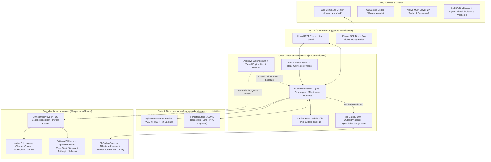
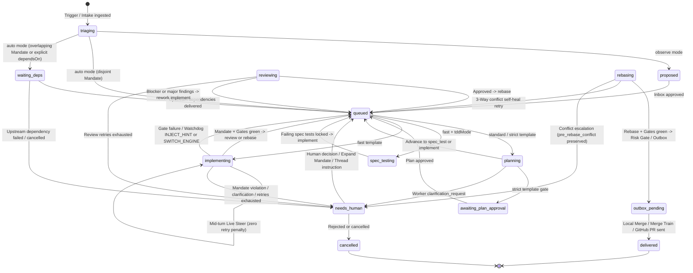

  <strong>English</strong> · <a href="./ARCHITECTURE.zh-CN.md">简体中文</a> · <a href="./README.md">README</a> · <a href="./USAGE.md">Usage Guide</a>

# `super-work` Architecture & Core Contracts

Grounded in the DeepSeek Harness team's essay *"Exploring Super-agent Design: Towards a More Autonomous Agent System"*, this document specifies the Dual-Harness architecture, ticket state machine, core invariants, and release evolution of `super-work` (`v1.8.3`).

> **Design Axiom**: The primary bottleneck in AI-assisted engineering is **human attention bandwidth**, not single-turn LLM intelligence. `super-work` decouples persistent lightweight governance/triage from sandboxed coding execution, gating every external side effect through deterministic verification and an idempotent `Transactional Outbox`.

---

## Table of Contents

1. [System Topology — Dual-Harness Architecture](#1-system-topology--dual-harness-architecture)
2. [Ticket Stage Pipeline State Machine](#2-ticket-stage-pipeline-state-machine)
3. [Core Architectural Contracts](#3-core-architectural-contracts)
4. [Release Evolution Log (`v0.4` → `v1.8.3`)](#4-release-evolution-log-v04--v183)

---

## 1. System Topology — Dual-Harness Architecture

### Package Dependency Boundary
- **`@super-work/core`**: Pure TypeScript domain types, orchestration state machines, Mandate/Risk/Playbook evaluators, and JSON-RPC 2.0 MCP protocol (`0` UI or driver runtime dependencies; exports `./types` subpath for type-only consumers).
- **`@super-work/drivers`**: Concrete adapters (`SqliteStateStore`, `FsArtifactStore`, `GitWorktreeProvider`, `Seatbelt`/`bwrap` OS sandbox, CLI & HTTP Control-Plane LLMs, CLI & `ApiWorkerDriver` workers, `GhOutboxExecutor`, `BunSelfHostRunner`, `ServiceManager`).
- **`@super-work/server`**: Hono REST routes (`routes/*`), `LiveEventBuffer` SSE broadcaster, HMAC webhook endpoints, and static Web bundle host.
- **`@super-work/cli`**: Terminal client (`super-work do`, `inbox`, `steer`, `milestone`, `doctor`, `service`) and `super-work mcp` stdio transport.
- **`@super-work/web`**: React 19 + Vite + Tailwind v4 UI. Imports `@super-work/core/types` **type-only** (`devDependency`), ensuring zero Node/core runtime code enters browser chunks (all chunks `< 500 kB`).

---

## 2. Ticket Stage Pipeline State Machine

---

## 3. Core Architectural Contracts

### 3.1 Dual-Harness Execution & Peer `ModelProfile` Registry
Defined in [model-registry.ts](./packages/core/src/model-registry.ts), [control-plane-symmetric.ts](./packages/drivers/src/llm/control-plane-symmetric.ts), [api-worker-driver.ts](./packages/drivers/src/workers/api-worker-driver.ts), and [model-discovery.ts](./packages/drivers/src/llm/model-discovery.ts):
- Every CLI engine (`kind: "cli"`, `cliEngine: "claude" | "codex" | "opencode" | "gemini"`) and HTTP model (`kind: "api"`, `apiProtocol: "deepseek" | "openai" | "anthropic" | "ollama"`) is a peer **`ModelProfile`** in `SystemSetupConfig.modelProfiles`.
- Any ready `ModelProfile` can serve **Control** (`controlModelId`, or `"heuristic"`), **Implement** (`implementModelId`, or `"auto"`), or **Cross-Review** (`reviewModelId`, or `"auto"` heterogeneous selection).
- API keys are persisted only in local SQLite (`PublicModelProfile` masks keys and never echoes raw secrets); `POST /api/setup/models` (alias `/api/setup/model`) probes `/models`, `/v1/models`, `/model`, `/v1/model` (+ Ollama `/api/tags`) with key redaction.
- Router prompts ([worker-mandate-rule.ts](./packages/drivers/src/llm/worker-mandate-rule.ts)) and Worker prompts ([memory.ts](./packages/core/src/memory.ts)) enforce a strict **Mandate Side-Effect Rule**: Workers never receive or execute `git push`, `gh pr create`, or release `git tag` instructions.

### 3.2 Immutable `Mandate`, Worktree Isolation & OS Sandboxes
Defined in [mandate.ts](./packages/core/src/mandate.ts) and [os-sandbox.ts](./packages/drivers/src/sandbox/os-sandbox.ts):
- **Pre-dispatch Scope Serialization**: `mandateScopesOverlap(a, b)` serializes overlapping tickets via `dependsOn` (`waiting_deps`) while running disjoint scopes in parallel `git worktree` directories (mirroring monorepo `packages/*` symlinks and running `setupCommands`).
- **OS-Level & Post-Turn Guardrails**: macOS `sandbox-exec` (Seatbelt) and Linux `bwrap` confine writes to the active worktree, lock `IMMUTABLE_REPO_PATHS` (`super-work.json`) and TDD `lockedTestPaths` read-only, scrub secret env vars, and preserve `localhost:*` loopback in `balanced` mode (`strict` disables network during gates). Post-turn `validateChangedFilesAgainstMandate` immediately reverts `forbiddenViolations` while quarantining ordinary `scopeViolations` in-place for zero-reburn `expandMandate` approval.

### 3.3 Smart Intake, Read-Only Repo Probes & Multi-Scale Orchestration
Defined in [intake.ts](./packages/core/src/intake.ts), [readonly-repo-prober.ts](./packages/drivers/src/workspace/readonly-repo-prober.ts), [milestone-coordinator.ts](./packages/core/src/kernel/milestone-coordinator.ts), and [campaign-coordinator.ts](./packages/core/src/kernel/campaign-coordinator.ts):
- **Two-Layer Probing**: `< 50 ms` deterministic symbol/slice/git pre-probes plus a bounded 2-round read-only tool loop jailed to `repo.rootPath` (blocking `.env*`, `*.pem`, `*.key`, and `forbiddenPaths`).
- **Unified Routing**: `POST /api/intake` routes natural-language requests (with explicit `scope:<glob>` extraction) into `single_ticket`, topological `epic_dag` (unified staging branch `super-work/epic/<id>` or cross-repo `HandoverDigest` barrier), or quantitative `goal_campaign` (monotonic regression rollback + plateau fuse).

### 3.4 Normalized `WorkerDriver` Stream, Live SSE Replay & Mid-Turn Steer
Defined in [ports.ts](./packages/core/src/ports.ts), [live-event-buffer.ts](./packages/server/src/live-event-buffer.ts), and [liveStream.ts](./packages/web/src/utils/liveStream.ts):
- Drivers emit normalized `WorkerStreamEvent` frames (`session_started`, `thought`, `tool_use`, `tool_result`, `text`, `usage`, `completed`, `error`), preserving native session IDs for zero-loss same-engine resume and synthesizing compact `InlineMemory` notes for cross-engine handover.
- `LiveEventBuffer` keeps the last `60` meaningful execution events across `40` recent tickets (LRU) and replays matching events immediately after `GET /api/events` `connected` (honoring `repoId` and `ticketId` + child-subtask filters).
- `steerTicket` (`abort("live_steer")`) interrupts an active turn without incrementing `stageRetries` or tripping engine health, injects `[LIVE STEER]`, and resumes cleanly.

### 3.5 `Inline & Spill` Tiered Memory, Playbook Hygiene & Episodic Casebook
Defined in [memory.ts](./packages/core/src/memory.ts), [playbook-hygiene.ts](./packages/core/src/playbook-hygiene.ts), and [sqlite-state-store.ts](./packages/drivers/src/storage/sqlite-state-store.ts):
- **Inline vs Spill**: Tickets keep compact structured state inline while spilling full JSONL transcripts, unified diffs, verification logs, and PNG captures to `<dataDir>/artifacts/<ticketId>/`.
- **Hygiene-Governed Memory**: `evaluatePlaybookRuleHygiene` blocks one-off approval/ticket-ID noise from polluting `playbook_entries` (opt-in `saveToPlaybook: true`, auditable via `GET/POST /api/playbooks/hygiene`). Delivered tickets distill `CasebookEntry` records searchable via FTS5, automatically flipping to pitfall warnings if `git revert`ed.

### 3.6 Adaptive Watchdog 2.0 & Tiered Engine Circuit Breaker
Defined in [watchdog.ts](./packages/core/src/watchdog.ts) and [engine-health.ts](./packages/core/src/engine-health.ts):
- **Watchdog 2.0**: L1 zero-LLM probes monitor silence, repeated errors, diff oscillation, and budget burn (auto-extending timeouts when active progress is observed); L2 diagnosis triggers `CONTINUE`, `INJECT_HINT`, `SWITCH_ENGINE`, or `ESCALATE_HUMAN`.
- **Tiered Circuit Breaker**: Classifies failures into `15 min` transient cooldowns vs `24 h` persistent trips (`quota_exhausted`, `auth_invalid`, `model_unsupported`, `tier_ineligible`), preventing repeated dispatch onto broken engines while at least one healthy real engine remains.

### 3.7 Deterministic Gates, Risk Scoring, Merge Train & 3-Way Conflict Resolution
Defined in [risk.ts](./packages/core/src/risk.ts), [merge-train.ts](./packages/core/src/merge-train.ts), and [conflict-resolver.ts](./packages/core/src/conflict-resolver.ts):
- **Layered Verification**: Supports `impact_scoped` package/test narrowing on `implement` (with `gate_reused` fast-forward reuse on unchanged `rebase` trees), ephemeral `$PORT` runtime `smokeCheck`, and zero-dep CDP headless browser + PNG pixel diff gates.
- **Risk Gate & Merge Train**: `evaluateTicketRisk` (`0–100`) gates `Transactional Outbox` entries under `AutonomyPreset` (`guarded` / `smart` / `autonomous`). `MergeTrain` takes a zero-overhead `Smart-Bypass` for single clean merges or speculatively stacks up to 3 `--no-ff` branches in `train-worktrees/`, bisecting failures while preserving per-ticket `git revert -m 1` SHAs.

### 3.8 Milestone Waves, Direct Squash Release & Self-Hosting Boot Canary
Defined in [milestone.ts](./packages/core/src/milestone.ts), [milestone-coordinator.ts](./packages/core/src/kernel/milestone-coordinator.ts), [git-milestone-release.ts](./packages/drivers/src/workspace/git-milestone-release.ts), and [self-host-coordinator.ts](./packages/core/src/kernel/self-host-coordinator.ts):
- **Wave & Direct Release**: `createMilestoneOp` schedules multi-item backlogs across non-overlapping topological waves (`direct_main` or zero-mid-signoff `milestone_branch`), **or**—when `targetVersion` is set with empty or pure release-housekeeping requirements (`isPureReleaseHousekeepingRequirement`)—transitions straight to `ready_to_release` with a `milestone_ready` Inbox card (`cancelMilestoneOp` / `POST /api/milestones/:id/cancel` cancels cleanly).
- **Lossless Squash, Tag & Push**: `executeMilestoneReleaseImpl` pre-checks clean working trees, existing local tags, and `gh auth status` before any Git mutation; in `direct_main` mode, `squashReleaseCommit` collapses unpushed `origin/<baseBranch>..HEAD` commits into a single commit verified for 100% `HEAD^{tree}` parity before tagging (`v<version>`), pushing, and optionally creating a GitHub Release.
- **Boot Canary Self-Reload**: Whenever a merge or milestone release updates `super-work`'s own `baseBranch`, `BunSelfHostRunner` builds and boots an ephemeral canary (`SUPER_WORK_CANARY_MODE=1`) probing `/api/health`; on pass it drains active turns, checkpoints SQLite WAL, and exits `75` for supervisor respawn — or automatically `git revert`s broken commits on failure.

---

## 4. Release Evolution Log (`v0.4` → `v1.8.3`)

- **`v0.4.0 – v0.9.0` (Foundational Kernel & Ecosystem)**: Dual-channel `Transactional Outbox` (`--no-ff` `local_merge` + `git revert -m 1` & GitHub PR follow-up loops), `super-work.json` repo contracts, self-evolving Playbook & FTS5 Casebook, Routines, Arena Duel, Adaptive Epic Re-plan, OS Seatbelt/`bwrap` sandboxes, CDP visual gates, Stage Checkpoints, Interactive DAG Studio, HMAC Webhooks, and zero-SDK Native MCP Server.
- **`v1.0.0` (GA Modularization & Review Studio)**: Decomposed kernel subdomains into `packages/core/src/kernel/*` coordinators; shipped `0–100` `evaluateTicketRisk` gate, Line-Anchored Review Studio (`ticket_review_comments`), 3-Way Semantic Conflict Resolver, `StageSpan` waterfalls, `SystemDoctor`, `VACUUM INTO` backups, and Task Blueprints.
- **`v1.1.0` (Agentic Control Plane & Golden Evals)**: Added two-layer `ReadOnlyRepoProber`, `⌘K` Chief-of-Staff (`POST /api/chief/ask`), batch Inbox triage, mid-turn `Live Steer`, structured `[ASK_HUMAN]` clarification, `StageToolProfile` telemetry, Golden Eval replay (`eval-worktrees/`), atomic DB restore, and Knowledge Bundles (**19 MCP tools**).
- **`v1.2.0` (Goal Campaigns, Merge Train & OS Service)**: Three-layer storage/kernel/server split; metric-driven `GoalCampaign` loops with monotonic rollback; Speculative Parallel `MergeTrain` + Cross-Repo Release Barrier; immutable `super-work.json` + deterministic lifecycle hooks; `launchd` / `systemd --user` `ServiceManager` (**21 MCP tools**).
- **`v1.3.0` (Self-Hosting Canary, Smart Intake & `GeminiCliDriver`)**: Unified `POST /api/intake` router, `BunSelfHostRunner` Boot Canary + WAL drain + exit-`75` hot reload (auto-revert on failure), `GeminiCliDriver`, monorepo worktree symlinks, and non-starving Outbox claims (**23 MCP tools**).
- **`v1.4.0` (Milestone Waves, Scoped Gates & Flight Recorder)**: Impact-scoped verification gate, topological `Milestone` wave scheduler + bilingual Release Notes synthesizer, surgical symbol/line context + Hotspot Radar, and SQLite Flight Recorder + Run Digest (**25 MCP tools**).
- **`v1.5.0` (Milestone Staging Branch & Lossless Squash)**: Added `integrationMode: "milestone_branch"` (`super-work/milestone/<id>`), tree-verified `squashReleaseCommit`, Engine Circuit Breaker (`GET/POST /api/system/engines`), Spillover Shield, and Released History archive (**26 MCP tools**).
- **`v1.6.0` (Playbook Hygiene, Gate Reuse KPIs & GitHub Release)**: Added `evaluatePlaybookRuleHygiene` + `manage_playbook_hygiene`, explicit opt-in `saveToPlaybook`, rebase gate-reuse & resilience KPIs in Flight Recorder, deterministic `quota_exhausted` classification, and pre-validated `createGithubRelease` (**27 MCP tools**).
- **`v1.7.0` (Tiered Breaker, Watchdog 2.0 KPIs & `@super-work/core/types`)**: Tiered 15m transient vs 24h persistent engine breaker, Milestone Boot Canary, Safe-Refactor auto-guards, Watchdog 2.0 extension & flake-retry digest counters, and zero-runtime `@super-work/core/types` Web isolation.
- **`v1.8.0` (Super-Agent First — Consumer Surface, Pro Engine)**: Single-bar `HeaderBar`, 3 spaces (`Home` / `History` / `Settings` + collapsible `Engine Room`), `Guarded / Smart / Autonomous` (`AutonomyPreset`) dial, 1-click Zero-Config Setup & repo auto-detect, `Approve / Answer / Unblock` verb taxonomy, and `super-work do` CLI.
- **`v1.8.1` (Unified Peer Model Pool & Symmetric Drivers)**: Unified CLI & API `ModelProfile` registry (`ModelRegistryStudio`), bidirectional symmetric Control-Plane & `ApiWorkerDriver` execution, per-CLI custom relay injection, `POST /api/setup/test-model`, safe profile deletion (`deleteModelProfileIds`), and per-task `preferredModelId` pinning.
- **`v1.8.2` (Dual-Harness Clarity, Smart Recipes & `/models` Discovery)**: Role-First `ModelRoleBoard`, 1-click Smart Recipes, pure `modelAdvisor` Anti-Pattern Advisor, progressive CLI relay disclosure, and live upstream `/models` & `/model` discovery (`POST /api/setup/models`, `FetchedModelPicker`).
- **`v1.8.3` (Toggleable Starters, Live Execution Feed & Direct Self-Hosted Release)**: Pure `starterComposer` toggle/cancel/switch state machine, server `LiveEventBuffer` SSE replay on connect, structured `liveStream` parser + inline `MissionRow` & `StreamTab` `LiveExecutionFeed` (phase-aware status badge + inline top-of-drawer `NeedsYouCard`), Router/Worker `git push` Mandate guardrails, 0-item / pure-housekeeping **Direct Release Milestones**, `POST /api/milestones/:id/cancel`, Home `NeedsYouCard` release controls, and `direct_main` `origin/<base>` lossless Squash.
