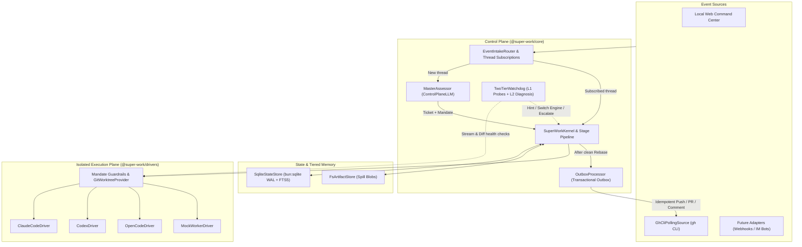
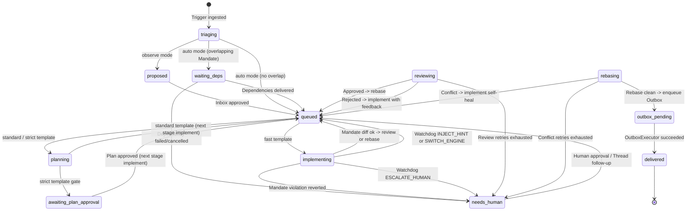

[English](./ARCHITECTURE.md) | [简体中文](./ARCHITECTURE.zh-CN.md)

# `super-work` Architecture & Core Contracts

Grounded in the design principles of DeepSeek Harness team's *"Exploring Super-agent Design: Towards a More Autonomous Agent System"*, this document specifies the layered architecture, state machine transitions, and hexagonal contracts of `super-work`.

> **Design Principle**: The primary bottleneck is **human attention bandwidth**, not single-turn LLM capability. `super-work` decouples persistent lightweight triage/supervision from isolated coding execution, ensuring external side effects are strictly gated through an idempotent `Transactional Outbox`.

---

## 1. System Overview

---

## 2. Ticket Stage Pipeline State Machine

---

## 3. Core Contracts & Mechanisms

### 3.1 `Mandate` & Concurrency Scope Governance
Defined in [mandate.ts](./packages/core/src/mandate.ts):
- **Immutable Scope**: Each `Ticket` receives a `Mandate` specifying `allowedPaths`, `forbiddenPaths` (always merging `DEFAULT_FORBIDDEN_PATHS`: `.env`, `.env.*`, `**/.env`, `**/.env.*`, `**/*.pem`, `**/*.key`), `allowNetwork`, `allowExternalSideEffects: false`, `maxCostUsd`, `maxDurationSec`, and `maxStageRetries`.
- **Pre-dispatch Serialization**: `mandateScopesOverlap(a, b)` checks wildcard and directory-prefix intersections against active non-terminal tickets in the same repository. Overlapping tickets automatically enter `dependsOn` (`waiting_deps`); disjoint scopes run concurrently in separate worktrees.
- **Dual Guardrails**:
  - **Pre-turn**: Worker drivers map stage permissions to CLI flags (`plan` / `review` run in read-only/plan mode; `implement` blocks `Bash(git push*)`, `Bash(gh pr *)`, `Bash(gh issue *)`).
  - **Post-turn**: `validateChangedFilesAgainstMandate(...)` inspects `GitWorktreeProvider.getChangedFiles(...)`. Violations are reverted via `revertPaths(...)` and escalated as `mandate_violation` items in the Attention Inbox.

### 3.2 Unified `WorkerDriver` & Cross-Engine Handover
Defined in [ports.ts](./packages/core/src/ports.ts) and implemented in `packages/drivers/src/workers/`:
- All worker drivers emit normalized `WorkerStreamEvent` streams (`session_started`, `thought`, `tool_use`, `tool_result`, `text`, `usage`, `completed`, `error`).
- **Same-engine resume**: Captures `nativeSessions[engine]` (`session_id` for `ClaudeCodeDriver`, `thread_id` for `CodexDriver`, `sessionID` for `OpenCodeDriver`) and resumes via `--resume` / `exec resume` / `--session`.
- **Cross-engine handover**: Between stages (e.g., `ClaudeCodeDriver` for `implement` → `CodexDriver` or `OpenCodeDriver` for `review`) or after a `SWITCH_ENGINE` recovery, `MemoryManager` synthesizes concise `InlineMemory` handover notes without leaking giant raw transcripts into the next model's context window.

### 3.3 `Inline & Spill` + `Chain of Recall`
Implemented in [memory.ts](./packages/core/src/memory.ts), [sqlite-state-store.ts](./packages/drivers/src/storage/sqlite-state-store.ts), and [fs-artifact-store.ts](./packages/drivers/src/storage/fs-artifact-store.ts):
- **Inline**: Compact `goal`, `acceptanceCriteria`, `planSummary`, `stageNotes`, `threadUpdates`, and `activeHint` stored on the `Ticket`.
- **Spill**: Full JSONL worker transcripts and unified `git diff` patches persisted as files under `<dataDir>/artifacts/<ticketId>/` and metadata-linked in SQLite `artifacts`.
- **Chain of Recall**: `SqliteStateStore.recallChain(ticketId)` reconstructs `Trigger -> Thread -> Ticket -> StageRuns -> SpillArtifacts`, augmented by sanitized `bun:sqlite` FTS5 search (`tokenizeFtsQuery`) across past tickets and stage notes.

### 3.4 Two-Tier `Watchdog`
Implemented in [watchdog.ts](./packages/core/src/watchdog.ts):
- **L1 Deterministic Probes (Zero LLM Cost)**: Detects `hard_budget_exceeded` (cost/duration ceiling), `repeated_error` (`>= 3` consecutive normalized error signatures), `diff_oscillation` (`A -> B -> A` worktree diff hash cycles), `silence_timeout`, and `budget_burn` (`>= 80%` cost spent with zero file edits).
- **L2 Semantic Diagnosis**: Invoked only upon an L1 `WatchdogSignal` (and within `maxStageRetries`). `ControlPlaneLLM.diagnoseWatchdog(...)` returns `CONTINUE`, `INJECT_HINT`, `SWITCH_ENGINE`, or `ESCALATE_HUMAN`.

### 3.5 `Transactional Outbox` & Rebase Gate
Implemented in [outbox.ts](./packages/core/src/outbox.ts) and [gh-cli-source.ts](./packages/drivers/src/sources/gh-cli-source.ts):
- Before delivery, `SuperWorkKernel` runs `GitWorktreeProvider.rebaseOntoBase(...)`. Merge conflicts trigger a self-heal `implement` retry or a `merge_conflict` Inbox item.
- Clean rebases enqueue an idempotent `OutboxEntry` (`idempotency_key` unique constraint in SQLite WAL). `OutboxProcessor.processDueEntries()` atomically claims due rows via `claimNextOutboxEntries` and executes `GhOutboxExecutor` (pushing & opening a GitHub PR when remote + `gh` are configured, or recording local branch readiness for local-only repos).
- **Worktree Lifecycle & GC**: When `repo.autoCleanupWorktree` is enabled (default), terminal `delivered` and `cancelled` tickets automatically reclaim their isolated worktree directory while retaining branch commits (`GET /api/tickets/:id` resolves diffs cleanly across Live Worktree → Branch Diff → Spill `diff` artifact). Stale or orphan directories can also be inspected and reclaimed via `/api/worktrees/gc`.
- **Deterministic Verification Gate**: When `repo.verificationCommands` is configured, `SuperWorkKernel` runs every command inside the worktree after `implement` and `rebase`, persisting full output as a `test_log` Spill artifact and emitting `verification_completed`. Failures automatically re-queue `implement` with diagnostic context or escalate after `maxStageRetries`.
- **Dual-Channel Delivery & Unified Epic Staging (`v0.4.0`)**: Epics default to a unified staging branch `super-work/epic/<epicId>` (with optional `per_subtask` fallback). After all subtasks merge into the staging branch, `finalizeUnifiedEpic` runs a final base-branch rebase and global verification gate (with 1 auto-fixup retry round) before opening a single consolidated PR or atomic `local_merge`.
- **Crash Recovery & Graded Mandate Expansion**: `SuperWorkKernel.recoverInterruptedRuns()` recovers orphaned active tickets and `processing` outbox entries without losing worktree state, `nativeSessions`, or `stageRetries`; `validateChangedFilesAgainstMandate` separates `forbiddenViolations` (reverted immediately) from `scopeViolations` (preserved pending Inbox `expandMandate` approval without re-running the worker).
- **PR Follow-up Loop, Repo Quotas & CLI**: `GhCliPollingSource` ingests PR reviews and `gh run view --log-failed` outputs while skipping `[super-work]` comments, triggering same-branch incremental updates (`GhOutboxExecutor`, capped at 3 rounds); `tick()` enforces per-repo `maxConcurrentWorkers` and soft `dailyBudgetUsd` caps alongside `/api/metrics` and `@super-work/cli`.
- **Repo Contracts (`super-work.json`), Self-Evolving Playbook & Worktree Warmup (`v0.5.0`)**: `GitWorktreeProvider.loadRepoContract` / `writeRepoContract` syncs shared engineering settings (`verificationCommands`, `setupCommands`, `forbiddenPaths`, `conventions`, shared `playbook`) from `super-work.json` while isolating personal runtime knobs in SQLite; `prepareWorkspace` executes `setupCommands` cleanly on fresh worktrees; closed-loop post-failure deliveries (`maybeDistillClosedLoopLesson`) and Inbox resolution notes (`distillHumanNoteToRule`) populate `playbook_entries` (`formatPlaybookContext` caps prompt injection at Top 8 rules / `<= 1200` chars).
- **Structured Adversarial Review, Safe `--no-ff` Revert & High-Signal Push**: `selectReviewEngine` prefers heterogeneous real engines (never falling back to `mock` for real code); `parseReviewReport` enforces `blocker`/`major` rework thresholds while passing `nit`-only reviews with persisted JSON `review_report` artifacts; `local_merge` uses `--no-ff` and records `mergedCommitSha` for non-destructive `git revert -m 1` via `revertMergedCommit`; `NotificationDispatcher` filters low-signal churn and delivers Inbox/delivery/failure alerts to macOS desktop notifications and Feishu/Slack/Discord/HMAC-signed Webhooks alongside `SUPER_WORK_TOKEN`-protected filtered `/api/events`.

### 3.6 `v1.0.0` GA Reliability, Code Review & Modularization Upgrades
- **Kernel Modularization (`packages/core/src/kernel/*`)**: Orchestration subdomains (Routines, Arena Duel, Adaptive Epic Replan, Stage Checkpoints & DAG Mutation, Line Review Comments, System Doctor & SQLite Hot Backups, and `SpanRecorder`) are decomposed into clean coordinator modules behind `KernelCoordinatorContext`, preserving 100% compatibility on `SuperWorkKernel`.
- **Confidence-Scored Delivery Risk Gate ([risk.ts](./packages/core/src/risk.ts))**: `evaluateTicketRisk(...)` scores `0–100` from diff lines, file spread, `sensitivePaths`, symbol fanout, visual pixel delta, retries/conflict history, minus verified TDD/static/smoke/review confidence deductions. Under `deliveryGatePolicy: "risk_gated"`, scores exceeding `riskThreshold` (default `35`) hold delivery in `outbox_signoff` (`"always_auto"` remains the non-breaking default).
- **Line-Anchored Review Studio ([review-comments-coordinator.ts](./packages/core/src/kernel/review-comments-coordinator.ts))**: Synchronizes AI `ReviewFinding` records into SQLite `ticket_review_comments`, accepts multi-line human baskets (`comment_only` vs `request_changes` rewinding to `implement`), and automatically marks open comments `resolved` when the subsequent `implement` pass modifies those files and clears verification.
- **3-Way Semantic Rebase Conflict Resolver ([conflict-resolver.ts](./packages/core/src/conflict-resolver.ts))**: Upon rebase conflicts, saves a `pre_rebase_conflict` hidden checkpoint, prepares a clean lockfile-free 3-way conflict workspace via `GitWorktreeProvider.prepareThreeWayConflictWorkspace`, runs at most 1 bounded resolution turn honoring `lockedTestPaths` + Mandate, verifies static/smoke gates, and rolls back to the checkpoint with full `ConflictSemanticContext` Inbox escalation if checks fail.
- **Stage Spans, System Doctor, Hot Backup & Composable Blueprints ([blueprints.ts](./packages/core/src/blueprints.ts))**: Records inline `StageSpan[]` waterfalls per `StageRun`; runs `SystemDoctor` diagnostics & cleanup across SQLite integrity, orphan worktrees, expired previews, and stale checkpoint Git refs alongside `VACUUM INTO` hot backups; resolves 5 built-in + custom `super-work.json` Task Blueprints under strict `explicit > blueprint > repo` precedence.

### 3.7 `v1.1.0` Agentic Control Plane, Live Steer & Golden Eval Platform
- **Hybrid Read-Only Control Plane Probing ([readonly-repo-prober.ts](./packages/drivers/src/workspace/readonly-repo-prober.ts))**: Pairs Layer 1 `<50ms` deterministic symbol/slice/git pre-probes (`HeuristicControlLLM` compatible) with a bounded 2-round Layer 2 read-only tool loop (`search_symbols`, `read_file_slice`, `grep_literals`, `git_recent_commits`) on `SpecStudio`, `EpicPlanner`, `Watchdog L2`, and path-ambiguous `triageTrigger`. All probe targets are strictly jailed to `repo.rootPath` via `isProbePathAllowed` + `realpath`, blocking `forbiddenPaths`, `.env*`, `*.pem`, and `*.key`.
- **Chief-of-Staff Omnibox & Batch Triage ([chief.ts](./packages/core/src/chief.ts))**: `runChiefOfStaffQuery` (`POST /api/chief/ask`, `super-work ask`) answers cross-repo operational questions from live tickets, metrics, FTS5 recall, and codebase probes while returning confirmation-gated `ChiefActionSuggestion[]` (never mutating automatically). Attention Inbox & `POST /api/inbox/batch-resolve` support multi-select & `Select Low-Risk` triage.
- **Mid-Turn Live Steer, Worker `[ASK_HUMAN]` & Tool Profiler ([tool-profiler.ts](./packages/core/src/tool-profiler.ts))**: `steerTicket(...)` aborts an in-flight turn via `abort("live_steer")` without incrementing `stageRetries` or polluting `failedEngines`, preserves the worktree and `nativeSessions`, prepends `[LIVE STEER]` to `activeHint`, and resumes smoothly. `extractWorkerClarificationRequest(...)` pauses on structured `[ASK_HUMAN]` blocks (max 1 per ticket) into `clarification_request` Inbox cards—or auto-adopts `recommendedOption` in `auto` mode. `buildStageToolProfile(...)` computes zero-LLM tool frequency, errors, and FIFO-matched latency per `StageRun`.
- **Golden Eval Suite, Atomic Backup Restore & Knowledge Bundles ([eval-coordinator.ts](./packages/core/src/kernel/eval-coordinator.ts), [knowledge-bundle-coordinator.ts](./packages/core/src/kernel/knowledge-bundle-coordinator.ts))**: `eval_cases` and `eval_runs` replay delivered tasks across multiple engines inside detached `<dataDir>/eval-worktrees/` directories with automatic `finally` cleanup and zero side effects on live tables. `SqliteStateStore.restoreFromBackup(...)` guards active runs, validates target snapshots via `PRAGMA quick_check`, creates an automatic `pre-restore` snapshot, swaps the DB file (cleaning `-wal`/`-shm`), and re-runs idempotent migrations. Repo Knowledge Bundles export/import Playbook + Casebook + Blueprints JSON cleanly; MCP upgrades to `1.1.0` with **19 tools**.

### 3.8 `v1.2.0` Goal Campaigns, Speculative Merge Train, Daemon Service & Lifecycle Contract Hardening
- **3-Layer Structural Split ([sqlite-schema.ts](./packages/drivers/src/storage/sqlite-schema.ts), [sqlite-mappers.ts](./packages/drivers/src/storage/sqlite-mappers.ts), [kernel.ts](./packages/core/src/kernel.ts), [app.ts](./packages/server/src/app.ts))**: Extracts SQLite DDL & row mapping out of `sqlite-state-store.ts`, separates core runtime coordinators into focused `kernel/*` modules (`campaign-coordinator.ts`, `merge-train-coordinator.ts`, `lifecycle-hooks.ts`, `contract-playbook-coordinator.ts`, `epic-lifecycle-coordinator.ts`, `inbox-resolution-coordinator.ts`, `stage-execution-coordinator.ts`), and groups Hono REST/MCP/webhook handlers into `packages/server/src/routes/*`.
- **Metric-Driven `GoalCampaign` ([campaign.ts](./packages/core/src/campaign.ts), [campaign-coordinator.ts](./packages/core/src/kernel/campaign-coordinator.ts))**: Benchmarks initial baseline metrics at `targetRef` via detached `metric-worktrees/`, dispatches sequential autonomous optimization waves onto an isolated `staging_branch` (`super-work/campaign/<id>`) or `per_wave_merge`, parses deterministic numeric output, executes **monotonic regression rollback** (`resetBranchRef`) on regressions/failures while logging pitfall lessons, and trips a 2-wave plateau / budget / max-iteration fuse into `campaign_paused` Inbox approval.
- **Speculative Parallel Merge Train & Cross-Repo Barrier ([merge-train.ts](./packages/core/src/merge-train.ts), [merge-train-coordinator.ts](./packages/core/src/kernel/merge-train-coordinator.ts))**: Evaluates `local_merge` deliveries under repo locks. Single-entry queues matching unchanged `baseBranch` HEAD with no pending barrier take `Smart-Bypass` zero-overhead fast path; larger queues build cumulative `--no-ff` slots (max 3) inside `train-worktrees/`, fast-forwarding `baseBranch` once to the deepest passing prefix while preserving individual merge SHAs so single-ticket `git revert -m 1` stays intact, bisecting/ejecting the first failing slot (`evaluateSpeculativePrefix`). Multi-repo Epics default to `barrierGroupId` (`releaseBarrier`), eagerly persisting `HandoverDigest` upon entering `barrier_waiting` so downstream cross-repo siblings avoid deadlocks.
- **Deterministic Hooks, Immutable `super-work.json` & `ServiceManager` ([lifecycle-hooks.ts](./packages/core/src/kernel/lifecycle-hooks.ts), [service-manager.ts](./packages/drivers/src/env/service-manager.ts))**: Enforces `IMMUTABLE_REPO_PATHS` (`super-work.json`, `**/super-work.json`) as OS-sandbox read-only (`readOnlyPaths`) and auto-reverted `forbiddenViolations` (`canExpandMandate: false`); executes blocking `pre_deliver` and non-blocking `post_deliver` / `on_escalate` hooks using `buildSanitizedWorkerEnv` (`SUPER_WORK_HOOK_*`); provides zero-dep `launchd` / `systemd --user` service units with `127.0.0.1` loopback guard, `10 MB` log rotation, and **21 MCP tools (`1.2.0`)**.
