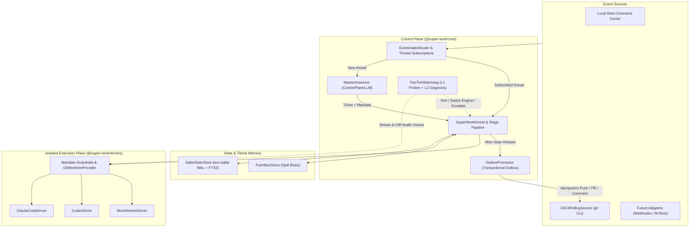
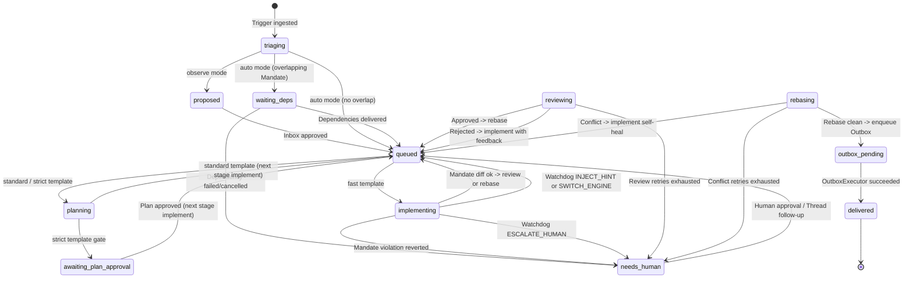

[English](./ARCHITECTURE.md) | [简体中文](./ARCHITECTURE.zh-CN.md)

# `super-work` Architecture & Core Contracts

Grounded in the design principles of DeepSeek Harness team's *"Exploring Super-agent Design: Towards a More Autonomous Agent System"*, this document specifies the layered architecture, state machine transitions, and hexagonal contracts of `super-work`.

> **Design Principle**: The primary bottleneck is **human attention bandwidth**, not single-turn LLM capability. `super-work` decouples persistent lightweight triage/supervision from isolated coding execution, ensuring external side effects are strictly gated through an idempotent `Transactional Outbox`.

---

## 1. System Overview

---

## 2. Ticket Stage Pipeline State Machine

---

## 3. Core Contracts & Mechanisms

### 3.1 `Mandate` & Concurrency Scope Governance
Defined in [mandate.ts](./packages/core/src/mandate.ts):
- **Immutable Scope**: Each `Ticket` receives a `Mandate` specifying `allowedPaths`, `forbiddenPaths` (always merging `DEFAULT_FORBIDDEN_PATHS`: `.env`, `.env.*`, `**/.env`, `**/.env.*`, `**/*.pem`, `**/*.key`), `allowNetwork`, `allowExternalSideEffects: false`, `maxCostUsd`, `maxDurationSec`, and `maxStageRetries`.
- **Pre-dispatch Serialization**: `mandateScopesOverlap(a, b)` checks wildcard and directory-prefix intersections against active non-terminal tickets in the same repository. Overlapping tickets automatically enter `dependsOn` (`waiting_deps`); disjoint scopes run concurrently in separate worktrees.
- **Dual Guardrails**:
  - **Pre-turn**: Worker drivers map stage permissions to CLI flags (`plan` / `review` run in read-only/plan mode; `implement` blocks `Bash(git push*)`, `Bash(gh pr *)`, `Bash(gh issue *)`).
  - **Post-turn**: `validateChangedFilesAgainstMandate(...)` inspects `GitWorktreeProvider.getChangedFiles(...)`. Violations are reverted via `revertPaths(...)` and escalated as `mandate_violation` items in the Attention Inbox.

### 3.2 Unified `WorkerDriver` & Cross-Engine Handover
Defined in [ports.ts](./packages/core/src/ports.ts) and implemented in `packages/drivers/src/workers/`:
- All worker drivers emit normalized `WorkerStreamEvent` streams (`session_started`, `thought`, `tool_use`, `tool_result`, `text`, `usage`, `completed`, `error`).
- **Same-engine resume**: Captures `nativeSessions[engine]` (`session_id` for `ClaudeCodeDriver`, `thread_id` for `CodexDriver`) and resumes via `--resume` / `exec resume`.
- **Cross-engine handover**: Between stages (e.g., `ClaudeCodeDriver` for `implement` → `CodexDriver` for `review`) or after a `SWITCH_ENGINE` recovery, `MemoryManager` synthesizes concise `InlineMemory` handover notes without leaking giant raw transcripts into the next model's context window.

### 3.3 `Inline & Spill` + `Chain of Recall`
Implemented in [memory.ts](./packages/core/src/memory.ts), [sqlite-state-store.ts](./packages/drivers/src/storage/sqlite-state-store.ts), and [fs-artifact-store.ts](./packages/drivers/src/storage/fs-artifact-store.ts):
- **Inline**: Compact `goal`, `acceptanceCriteria`, `planSummary`, `stageNotes`, `threadUpdates`, and `activeHint` stored on the `Ticket`.
- **Spill**: Full JSONL worker transcripts and unified `git diff` patches persisted as files under `<dataDir>/artifacts/<ticketId>/` and metadata-linked in SQLite `artifacts`.
- **Chain of Recall**: `SqliteStateStore.recallChain(ticketId)` reconstructs `Trigger -> Thread -> Ticket -> StageRuns -> SpillArtifacts`, augmented by sanitized `bun:sqlite` FTS5 search (`tokenizeFtsQuery`) across past tickets and stage notes.

### 3.4 Two-Tier `Watchdog`
Implemented in [watchdog.ts](./packages/core/src/watchdog.ts):
- **L1 Deterministic Probes (Zero LLM Cost)**: Detects `hard_budget_exceeded` (cost/duration ceiling), `repeated_error` (`>= 3` consecutive normalized error signatures), `diff_oscillation` (`A -> B -> A` worktree diff hash cycles), `silence_timeout`, and `budget_burn` (`>= 80%` cost spent with zero file edits).
- **L2 Semantic Diagnosis**: Invoked only upon an L1 `WatchdogSignal` (and within `maxStageRetries`). `ControlPlaneLLM.diagnoseWatchdog(...)` returns `CONTINUE`, `INJECT_HINT`, `SWITCH_ENGINE`, or `ESCALATE_HUMAN`.

### 3.5 `Transactional Outbox` & Rebase Gate
Implemented in [outbox.ts](./packages/core/src/outbox.ts) and [gh-cli-source.ts](./packages/drivers/src/sources/gh-cli-source.ts):
- Before delivery, `SuperWorkKernel` runs `GitWorktreeProvider.rebaseOntoBase(...)`. Merge conflicts trigger a self-heal `implement` retry or a `merge_conflict` Inbox item.
- Clean rebases enqueue an idempotent `OutboxEntry` (`idempotency_key` unique constraint in SQLite WAL). `OutboxProcessor.processDueEntries()` atomically claims due rows via `claimNextOutboxEntries` and executes `GhOutboxExecutor` (pushing & opening a GitHub PR when remote + `gh` are configured, or recording local branch readiness for local-only repos).
