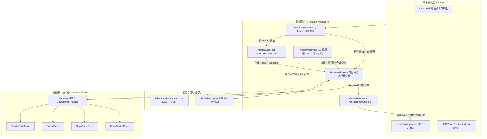
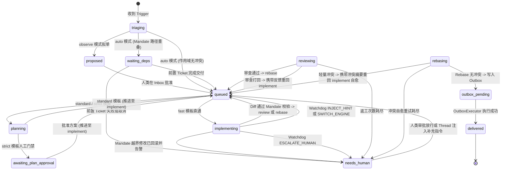

[English](./ARCHITECTURE.md) | [简体中文](./ARCHITECTURE.zh-CN.md)

# `super-work` 架构设计与核心契约

基于 DeepSeek Harness 团队《Super-agent 设计探索：迈向更自主的 Agent 系统》的核心思想，本文件定义了 `super-work` 的分层架构、阶段状态机以及四层 Bun Monorepo 核心契约。

> **核心设计信条**：系统的瓶颈是**人类的注意力带宽**而非单次模型推理。`super-work` 将开发者从“盯多个终端的微操员”转变为“审批边界与结果的决策者”——控制面常驻轻量调度，执行面复用成熟 Coding Agent，所有外部写副作用统一经由事务性发件箱（Transactional Outbox）受控释放。

---

## 1. 系统总体架构

---

## 2. Ticket 阶段状态机与跨引擎接力

---

## 3. 核心机制与契约

### 3.1 不可变 `Mandate` 与并发作用域治理
实现于 [mandate.ts](./packages/core/src/mandate.ts)：
- **授权契约**：每张 `Ticket` 携带不可变 `Mandate`，约束 `allowedPaths`、`forbiddenPaths`（强制合入 `DEFAULT_FORBIDDEN_PATHS`：`.env`、`.env.*`、`**/.env`、`**/.env.*`、`**/*.pem`、`**/*.key`）、`allowNetwork`、`allowExternalSideEffects: false`、`maxCostUsd`、`maxDurationSec` 与 `maxStageRetries`。
- **事前冲突预判**：`mandateScopesOverlap(a, b)` 在派单前检查同仓库活跃 Ticket 的路径通配符与目录前缀重合度；重叠自动写入 `dependsOn`（状态置为 `waiting_deps`），无重叠则各自在独立 worktree 并发推进。
- **双重护栏**：
  - **事前约束**：将阶段角色映射为 CLI 原生权限参数（`plan` / `review` 阶段限定只读/规划权限；`implement` 阶段禁用 `Bash(git push*)`、`Bash(gh pr *)`、`Bash(gh issue *)`）。
  - **事后审计**：调用 `validateChangedFilesAgainstMandate(...)` 校验 `GitWorktreeProvider.getChangedFiles(...)`。若发现越界或敏感文件修改，立即调用 `revertPaths(...)` 还原并向 Attention Inbox 提交 `mandate_violation` 卡片。

### 3.2 统一 `WorkerDriver` 协议与跨引擎接力
接口定义于 [ports.ts](./packages/core/src/ports.ts)，驱动实现于 `packages/drivers/src/workers/`：
- 所有执行器统一产出归一化 `WorkerStreamEvent` 流（`session_started`、`thought`、`tool_use`、`tool_result`、`text`、`usage`、`completed`、`error`）。
- **同引擎原生续跑**：捕获并持久化 `nativeSessions[engine]`（`ClaudeCodeDriver` 的 `session_id` / `CodexDriver` 的 `thread_id` / `OpenCodeDriver` 的 `sessionID`），下轮同引擎优先通过 `--resume` / `exec resume` / `--session` 复用上下文与缓存。
- **跨引擎无缝交接**：在不同阶段（如 `ClaudeCodeDriver` 编码 → `CodexDriver` / `OpenCodeDriver` 独立审查）或 Watchdog 触发 `SWITCH_ENGINE` 时，`MemoryManager` 自动提炼紧凑的 `InlineMemory` 阶段交接摘要，避免将巨量原始历史塞入新引擎上下文窗口。

### 3.3 `Inline & Spill` 分层记忆与 `Chain of Recall`
实现于 [memory.ts](./packages/core/src/memory.ts)、[sqlite-state-store.ts](./packages/drivers/src/storage/sqlite-state-store.ts) 与 [fs-artifact-store.ts](./packages/drivers/src/storage/fs-artifact-store.ts)：
- **Inline（内联记忆）**：在 `Ticket` 内仅维护轻量结构化字段（`goal`、`acceptanceCriteria`、`planSummary`、`stageNotes`、`threadUpdates`、`activeHint`）。
- **Spill（溢出产物）**：完整 JSONL 执行流与工作树统一 Diff 补丁落盘至 `<dataDir>/artifacts/<ticketId>/`，并在 SQLite `artifacts` 表登记元数据。
- **Chain of Recall（链式召回）**：`SqliteStateStore.recallChain(ticketId)` 串联还原 `Trigger -> Thread -> Ticket -> StageRuns -> SpillArtifacts` 完整血缘链，并结合转义安全处理的 `bun:sqlite` FTS5 全文检索（`tokenizeFtsQuery`）按需召回关联历史任务。

### 3.4 两级混合 `Watchdog`
实现于 [watchdog.ts](./packages/core/src/watchdog.ts)：
- **L1 零成本规则探针**：实时监控 `hard_budget_exceeded`（费用/时长硬上限）、`repeated_error`（连续 `>= 3` 次相同签名报错）、`diff_oscillation`（工作树 Diff 哈希出现 `A -> B -> A` 往复振荡）、`silence_timeout`（流式输出静默超时）及 `budget_burn`（预算消耗达 80% 仍无代码变更）。
- **L2 语义诊断**：仅在 L1 触发告警且未超出 `maxStageRetries` 时唤醒 `ControlPlaneLLM.diagnoseWatchdog(...)`，输出结构化决策：`CONTINUE`、`INJECT_HINT`、`SWITCH_ENGINE` 或 `ESCALATE_HUMAN`。

### 3.5 `Transactional Outbox` 与交付门禁
实现于 [outbox.ts](./packages/core/src/outbox.ts) 与 [gh-cli-source.ts](./packages/drivers/src/sources/gh-cli-source.ts)：
- 交付前由 `SuperWorkKernel` 自动执行 `GitWorktreeProvider.rebaseOntoBase(...)`；若发生冲突则优先注入冲突文件摘要唤醒 Worker 自愈，超出重试上限再升级人工处理。
- Rebase 干净后写入带 SQLite `UNIQUE(idempotency_key)` 约束的 `OutboxEntry`；`OutboxProcessor.processDueEntries()` 通过事务方法 `claimNextOutboxEntries` 原子认领任务并交由 `GhOutboxExecutor` 执行（有远端及 `gh` 授权时自动 Push 分支并建 PR，纯本地仓库则完成本地分支交付汇总）。
- **Worktree 生命周期与 GC**：启用仓库 `autoCleanupWorktree`（默认开启）时，任务到达 `delivered` 或被 `cancelTicket` 取消后会自动移除工作树目录并保留提交分支；即使清理后，`GET /api/tickets/:id` 仍可通过 `GitWorktreeProvider.getBranchDiff(...)` 回看分支 Diff，也可通过 `/api/worktrees/gc` 回收历史或孤儿目录。

### 3.6 插件系统：契约、加载器与管理 API
契约定义于 [plugin.ts](./packages/core/src/plugin.ts)(纯类型),加载器实现于 `packages/drivers/src/plugins/`,由 [plugin-routes.ts](./packages/server/src/plugin-routes.ts) 暴露 API,并由 `packages/web/src/views/PluginsView.tsx` 渲染管理面板。

**契约(`@super-work/core`)**
- `PluginManifest`:`id`(`^[a-z0-9][a-z0-9._-]{0,63}$`)、`name`、`version`(semver)、`kind`(`driver` | `trigger` | `outbox` | `llm` | `tool`)、`capabilities`(按 `kind` 约定语义的自由标签),以及可选的 `description` 与 `configSchema`。
- `configSchema` 为精简的 JSON-Schema 子集:`type: "object"`、`properties`(每项为 `string` | `number` | `boolean` | `array` | `object`,可带 `description`、`default`、`enum`、`secret`)与 `required`。
- `PluginStatus` 按 `state`(`loaded` | `enabled` | `disabled` | `failed`)区分;`failed` 状态必带 `error`。`PluginEvent`:`plugin_loaded`、`plugin_unloaded`、`plugin_enabled`、`plugin_disabled`、`plugin_failed`。
- 端口:`PluginRegistryReader`(`get`、`list`)、`PluginRegistry`(额外提供 `register`、`unregister`、`subscribe`)与 `PluginLoaderPort`(`load`、`unload`、`list`、`enable`、`disable`)。

**加载流程(`@super-work/drivers` 中的 `PluginLoader`)**
1. **发现**:`discover()` 扫描 `pluginsDir` 下的 `<dir>/<name>/plugin.json`;`load(source)` 接受插件目录或 manifest 文件路径。
2. **校验**:`validateManifest` 校验 manifest;失败会被记录为 `failed` 插件(`load()` 同时会重新抛出错误,`discover()` / `restore()` 则吞掉错误)。
3. **导入**:入口取自 manifest 的可选 `main`(必须位于插件目录内),否则依次尝试 `index.ts` / `index.js` / `index.mjs`。入口须导出(`default` 或具名)`activate(config)`,可选导出 `deactivate(instance)`。
4. **注册**:插件以 `loaded` 状态进入注册表;重复 id 会被拒绝,且不会覆盖健康的已有插件。
5. **启用**:`enable(id, config?)` 按 `configSchema` 校验配置,在超时保护(默认 10 秒)下调用 `activate(config)`,成功后进入 `enabled`;任何错误都会使该插件进入 `failed`,单个插件故障不会影响其他插件。对已启用的插件再次 `enable` 为空操作,直接返回当前状态。
6. **停用 / 卸载**:以激活得到的实例调用 `deactivate`;`disable` 保留注册并置为 `disabled`,`unload` 则移除。同一插件 id 的操作串行执行。
7. **持久化与恢复**:状态通过 `PluginStateStore`(`SqlitePluginStateStore`,表 `plugins`)保存,标记为 `secret` 的属性**绝不落盘**。启动时 `restore()` 会重新加载已持久化的非内置插件。

`registerBuiltinPlugins(loader)` 通过同一路径注册内置驱动:`worker-claude-code`、`worker-codex`、`worker-opencode`(配置项 `binary`)、`worker-mock`、`llm-heuristic` 与 `outbox-gh`。该函数纯增量,原有驱动类与导出保持不变。

**管理 API(`@super-work/server`)**

| 端点 | 行为 |
| :--- | :--- |
| `GET /api/plugins?kind=&state=` | 列出插件;非法 `kind` / `state` → `400` |
| `GET /api/plugins/:id` | 查询单个插件;id 不存在 → `404` |
| `POST /api/plugins/:id/enable` | 可选请求体 `{ "config": {...} }`;违反 schema → `400` 并附带 `details` |
| `POST /api/plugins/:id/disable` | 停用插件 |
| `PUT /api/plugins/:id/config` | 请求体 `{ "config": {...} }`;仅在 `enabled` 状态下有效,否则 `409` |

配置会按 schema 校验(未知键、类型错误、enum 与 `required` 违规均被拒绝)。加载器拒绝操作时返回 `409`。所有响应都会把 `secret` 属性掩码为 `****`,密钥不会离开服务端。

> **当前接线**:`createApp` 在传入 `pluginRegistry` 与 `pluginLoader` 时注册上述路由。随附的服务入口(`packages/server/src/index.ts`)目前接入的是内存版 `RegistryBackedPluginLoader`,它只在内存中记录状态切换,不会发现插件目录,也不会实例化运行时。在该接缝处注入 drivers 的 `PluginLoader`(配合 `registerBuiltinPlugins`、`discover()` 与 `restore()`)即可启用真实插件。
