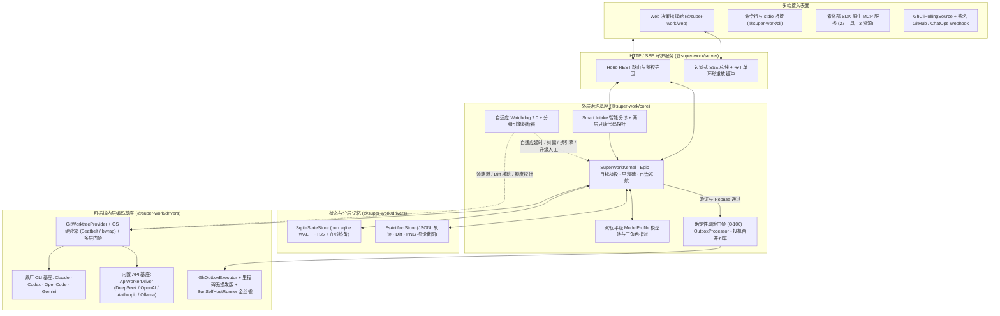
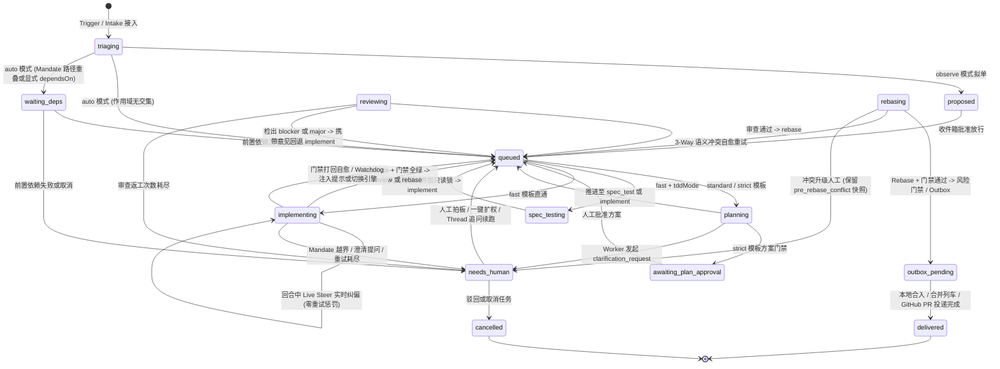

  <a href="./ARCHITECTURE.md">English</a> · <strong>简体中文</strong> · <a href="./README.zh-CN.md">README</a> · <a href="./USAGE.zh-CN.md">使用指南</a>

# `super-work` 架构设计与核心契约

基于 DeepSeek Harness 团队《*Super-agent 设计探索：迈向更自主的 Agent 系统*》的核心思想，本文档定义 `super-work`（`v1.8.3`）的双基座总体拓扑、工单阶段状态机、八大核心契约与版本演进脉络。

> **核心设计公理**：AI 辅助研发的主要瓶颈是**人类的注意力带宽**而非单轮模型推理能力。`super-work` 将常驻轻量的分诊监督控制面与沙箱隔离的编码执行面彻底解耦，所有外部写副作用均须通过确定性质量门禁与幂等的 `Transactional Outbox` 受控释放。

---

## 目录

1. [系统总体拓扑 —— 双基座（Dual-Harness）架构](#1-系统总体拓扑--双基座dual-harness架构)
2. [工单阶段流水线状态机](#2-工单阶段流水线状态机)
3. [八大核心架构契约](#3-八大核心架构契约)
4. [版本演进志（`v0.4` → `v1.8.3`）](#4-版本演进志v04--v183)

---

## 1. 系统总体拓扑 —— 双基座（Dual-Harness）架构

### Monorepo 五包依赖边界
- **`@super-work/core`**：纯 TypeScript 领域类型、编排状态机、Mandate/风险/经验卫生评估器与原生 MCP JSON-RPC 2.0 协议（零 UI 与零具体驱动运行时依赖；通过 `./types` 子路径导出纯类型契约）。
- **`@super-work/drivers`**：六边形端口适配器实现（`SqliteStateStore`、`FsArtifactStore`、`GitWorktreeProvider`、macOS Seatbelt / Linux `bwrap` 原生沙箱、CLI 与 HTTP 控制面模型驱动、四大原厂 CLI Worker 与内置 `ApiWorkerDriver`、`GhOutboxExecutor`、`BunSelfHostRunner`、`ServiceManager`）。
- **`@super-work/server`**：模块化 Hono 路由（`routes/*`）、`LiveEventBuffer` SSE 回放总线、HMAC 签名 Webhook 端点及静态前端托管。
- **`@super-work/cli`**：命令行客户端（`super-work do`、`inbox`、`steer`、`milestone`、`doctor`、`service`）及 `super-work mcp` stdio 桥接器。
- **`@super-work/web`**：React 19 + Vite + Tailwind v4 前端指挥舱。仅通过 `devDependency` 以 `import type` 引用 `@super-work/core/types`，确保零 Node/core 运行时代码打入浏览器产物（所有 JS 分包均 `< 500 kB`）。

---

## 2. 工单阶段流水线状态机

---

## 3. 八大核心架构契约

### 3.1 双基座执行体系与平级 `ModelProfile` 注册表
实现于 [model-registry.ts](./packages/core/src/model-registry.ts)、[control-plane-symmetric.ts](./packages/drivers/src/llm/control-plane-symmetric.ts)、[api-worker-driver.ts](./packages/drivers/src/workers/api-worker-driver.ts) 与 [model-discovery.ts](./packages/drivers/src/llm/model-discovery.ts)：
- 本机 CLI（`kind: "cli"`，`cliEngine: "claude" | "codex" | "opencode" | "gemini"`）与直连 HTTP API（`kind: "api"`，`apiProtocol: "deepseek" | "openai" | "anthropic" | "ollama"`）在 `SystemSetupConfig.modelProfiles` 中共享完全平级的 `ModelProfile` 结构。
- 任一 `ready` 配置均可自由指派给 **控制模型**（`controlModelId` 或 `"heuristic"`）、**工作实现模型**（`implementModelId` 或 `"auto"`）与 **交叉审查模型**（`reviewModelId` 或 `"auto"` 优先异构模型盲审）。
- 原始 API Key 仅落盘于服务端本地 SQLite（前端仅接收掩码态 `PublicModelProfile`）；`POST /api/setup/models`（别名 `/api/setup/model`）按协议鉴权头探测上游 `/models`、`/v1/models`、`/model`、`/v1/model`（及本地 Ollama `/api/tags`）并脱敏异常信息。
- 控制面路由规则（[worker-mandate-rule.ts](./packages/drivers/src/llm/worker-mandate-rule.ts)）与执行面提示词（[memory.ts](./packages/core/src/memory.ts)）严格对齐副作用边界：严禁向隔离 worktree 中的 Worker 生成或执行 `git push`、`gh pr create` 或远端打标指令。

### 3.2 不可变 `Mandate`、工作树隔离与 OS 原生硬沙箱
实现于 [mandate.ts](./packages/core/src/mandate.ts) 与 [os-sandbox.ts](./packages/drivers/src/sandbox/os-sandbox.ts)：
- **派单前路径并发仲裁**：`mandateScopesOverlap(a, b)` 对路径重叠的活跃工单自动注入 `dependsOn`（`waiting_deps`），无重叠工单在各自独立 `git worktree` 中并发推进（自动镜像 Monorepo `packages/*` 符号链接并执行 `setupCommands` 预热）。
- **内核级硬沙箱与分级越界处理**：macOS `sandbox-exec`（Seatbelt）与 Linux `bwrap` 强制锁死当前 worktree 写权限，将 `IMMUTABLE_REPO_PATHS`（`super-work.json`）及 TDD `lockedTestPaths` 挂载为只读，脱敏敏感环境变量并在 `balanced` 模式保留 `localhost:*` 本地测试回环（`strict` 模式门禁彻底断网）。回合结束后 `validateChangedFilesAgainstMandate` 对敏感禁区立即回滚，对普通越界改动原地保留在工作树以支持收件箱 **「一键扩权并继续」** 免重烧 Token。

### 3.3 Smart Intake 智能分诊、两层只读代码探针与多尺度编排
实现于 [intake.ts](./packages/core/src/intake.ts)、[readonly-repo-prober.ts](./packages/drivers/src/workspace/readonly-repo-prober.ts)、[milestone-coordinator.ts](./packages/core/src/kernel/milestone-coordinator.ts) 与 [campaign-coordinator.ts](./packages/core/src/kernel/campaign-coordinator.ts)：
- **两层安全探针**：结合 `< 50 ms` 确定性符号/切片/最近提交预勘探与最多 2 轮有界只读工具循环（经 `realpath` 锁定在仓库根目录，严禁触碰 `.env*`、`*.pem`、`*.key` 与 `forbiddenPaths`）。
- **多尺度自动路由**：`POST /api/intake` 解析显式 `scope:<glob>` 令牌，将自然语言需求精准路由为单工单（`single_ticket`）、拓扑并发 `Epic DAG`（统一集成分支 `super-work/epic/<id>` 或跨仓 `HandoverDigest` 释放屏障），或指标驱动的 `goal_campaign`（带单调回退与连续滞涨熔断）。

### 3.4 归一化 `WorkerDriver` 事件流、SSE 断线重放与实时纠偏
实现于 [ports.ts](./packages/core/src/ports.ts)、[live-event-buffer.ts](./packages/server/src/live-event-buffer.ts) 与 [liveStream.ts](./packages/web/src/utils/liveStream.ts)：
- 所有 Worker 统一输出 `WorkerStreamEvent` 流（`session_started`、`thought`、`tool_use`、`tool_result`、`text`、`usage`、`completed`、`error`）；同引擎通过 `nativeSessions` 原生续跑，跨引擎切换由 `MemoryManager` 提炼紧凑 `InlineMemory` 交接摘要。
- `LiveEventBuffer` 在服务端内存按工单维护环形缓冲（最近 `40` 个工单 × 每单 `60` 条关键事件，LRU 淘汰），客户端连接 `GET /api/events` 后立即按 `repoId` / `ticketId`（穿透子任务）重放近期轨迹，前端去重并 `100 ms` 防抖刷新。
- `steerTicket` 通过 `abort("live_steer")` 温和中止在途回合并注入 `[LIVE STEER]`，不累加 `stageRetries`、不触发引擎熔断，保留工作树与会话无缝续跑。

### 3.5 `Inline & Spill` 分层记忆、经验库卫生与历史判例召回
实现于 [memory.ts](./packages/core/src/memory.ts)、[playbook-hygiene.ts](./packages/core/src/playbook-hygiene.ts) 与 [sqlite-state-store.ts](./packages/drivers/src/storage/sqlite-state-store.ts)：
- **内联与溢出分离**：工单行内仅保留轻量结构化记忆，完整 JSONL 轨迹、Diff 补丁、测试日志与 PNG 截图落盘至 `<dataDir>/artifacts/<ticketId>/` 按需读取。
- **防污染经验与判例沉淀**：`evaluatePlaybookRuleHygiene` 拦截一次性审批口令与工单号噪声（收件箱备注需显式 `saveToPlaybook: true` 且通过卫生评估才写入）；已交付工单自动沉淀 FTS5 可检索的 `CasebookEntry`，一旦被 `git revert` 则自动翻转为反面避坑警示。

### 3.6 自适应 Watchdog 2.0 与分级引擎熔断器
实现于 [watchdog.ts](./packages/core/src/watchdog.ts) 与 [engine-health.ts](./packages/core/src/engine-health.ts)：
- **Watchdog 2.0**：L1 零成本探针监测流静默、连续同签名报错、Diff 往复振荡与空烧预算（检测到有效推进时自动延时并记录 `watchdog_extended`）；L2 语义诊断输出 `CONTINUE`、`INJECT_HINT`、`SWITCH_ENGINE` 或 `ESCALATE_HUMAN`。
- **分级熔断冷却**：瞬时网络/进程异常冷却 `15 分钟`，确定性持久异常（`quota_exhausted`、`auth_invalid`、`model_unsupported`、`tier_ineligible`）熔断 `24 小时` 并自动切备选健康引擎接力。

### 3.7 多层确定性门禁、风险评分、投机合并列车与 3-Way 冲突消解
实现于 [risk.ts](./packages/core/src/risk.ts)、[merge-train.ts](./packages/core/src/merge-train.ts) 与 [conflict-resolver.ts](./packages/core/src/conflict-resolver.ts)：
- **三层门禁与复用**：支持按 Diff 波及包精简校验的 `impact_scoped` 增量门禁（Rebase 树未变时触发 `gate_reused` 零重复耗时复用）、动态端口 `smokeCheck` 服务探针，以及零依赖 CDP 无头浏览器 + PNG 像素差异门禁。
- **风险评分与合并列车**：`evaluateTicketRisk`（`0–100`）配合 `AutonomyPreset` 决定自动放行或转入 `outbox_signoff`；`MergeTrain` 对单笔干净合入启用 `Smart-Bypass` 直通，多笔并发时在 `train-worktrees/` 内最多叠加 3 槽位投机验证并二分剔除失败项，同时保留每单独立 `--no-ff` Merge SHA 支持一键 `git revert -m 1`。

### 3.8 里程碑波次编排、直接无损 Squash 发版与 Boot Canary 自举重载
实现于 [milestone.ts](./packages/core/src/milestone.ts)、[milestone-coordinator.ts](./packages/core/src/kernel/milestone-coordinator.ts)、[git-milestone-release.ts](./packages/drivers/src/workspace/git-milestone-release.ts) 与 [self-host-coordinator.ts](./packages/core/src/kernel/self-host-coordinator.ts)：
- **多波次与零工单直接发版**：`createMilestoneOp` 支持多需求拓扑波次推进（`direct_main` 或单次签收的 `milestone_branch`），也支持在填写 `targetVersion` 且需求为空或纯属发版收尾描述（`isPureReleaseHousekeepingRequirement`）时，直接生成 `ready_to_release` 里程碑与首页 `milestone_ready` 待拍板卡片（`POST /api/milestones/:id/cancel` 支持安全取消）。
- **树一致性无损 Squash、打标与推送**：`executeMilestoneReleaseImpl` 在修改任何 Git 历史前预检干净工作树、同名本地 Tag 是否存在以及 `gh auth status`；`direct_main` 模式下启用 `squashReleaseCommit` 时，自动将 `origin/<baseBranch>..HEAD` 所有未推送提交软重置压缩为单个发布提交，严格校验压缩前后 `HEAD^{tree}` SHA 100% 一致后再创建注释 Tag、推送远端并按需创建 GitHub Release。
- **Boot Canary 自举热重载**：每当改动合入或发版提交落入 `super-work` 自身主干，`BunSelfHostRunner` 自动编译并在随机端口以 `SUPER_WORK_CANARY_MODE=1` 冷启探活 `/api/health`；探活通过后排空在途任务、执行 `PRAGMA wal_checkpoint(TRUNCATE)` 并以退出码 `75` 触发守护器秒级重启；若失败则自动 `git revert` 坏提交，确保在线守护进程永不掉线。

---

## 4. 版本演进志（`v0.4` → `v1.8.3`）

- **`v0.4.0 – v0.9.0`（编排内核与生态奠基）**：落地双通道 `Transactional Outbox`（`--no-ff` 本地合入 + 一键 `git revert -m 1` 与 GitHub PR 自动返修）、`super-work.json` 工程契约、自进化 Playbook 与 FTS5 Casebook、定时巡航、Arena 双引擎竞速、自适应 Epic 重规划、OS Seatbelt/`bwrap` 硬沙箱、CDP 视觉门禁、阶段快照、交互式 DAG Studio、双向签名 Webhook 与零外部 SDK 原生 MCP 服务。
- **`v1.0.0`（GA 模块化拆分与行级审查台）**：将内核子域拆分为 `packages/core/src/kernel/*` 协调器；上线 `0–100` `evaluateTicketRisk` 风险门禁、行级锚定审查工作台（`ticket_review_comments`）、3-Way 语义冲突消解器、`StageSpan` 耗时瀑布流、`SystemDoctor`、`VACUUM INTO` 热备与可组合任务蓝图。
- **`v1.1.0`（智能探针控制面与黄金评测台）**：上线两层只读代码探针 `ReadOnlyRepoProber`、`⌘K` 幕僚长问答（`POST /api/chief/ask`）、收件箱低风险批量签批、回合中 `Live Steer`、结构化 `[ASK_HUMAN]` 澄清提问、`StageToolProfile` 工具画像、隔离 `eval-worktrees/` 黄金评测回放、原子热恢复与跨仓知识包（**19 个 MCP 工具**）。
- **`v1.2.0`（目标战役、投机合并列车与系统常驻服务）**：完成存储/内核/路由三层拆分；上线指标驱动 `GoalCampaign` 循环与单调回退、并行投机 `MergeTrain` 与跨仓屏障、只读不可变 `super-work.json` + 确定性生命周期 Hooks，以及 `launchd` / `systemd --user` 常驻服务管理（**21 个 MCP 工具**）。
- **`v1.3.0`（自举金丝雀热演进、Smart Intake 与 `GeminiCliDriver`）**：上线 `POST /api/intake` 智能需求直投、`BunSelfHostRunner` Boot Canary + WAL 排空热重载（失败自动 Revert）、`GeminiCliDriver`、Monorepo 工作树软链镜像与无饥饿 Outbox 认领（**23 个 MCP 工具**）。
- **`v1.4.0`（里程碑波次编排、增量门禁与飞行记录仪）**：上线影响面增量验证门禁、多需求拓扑波次 `Milestone` 与双语发布说明合成器、符号/行号精准地图注入 + 代码热点雷达，以及 SQLite 飞行记录仪与运行摘要（**25 个 MCP 工具**）。
- **`v1.5.0`（里程碑暂存分支与无损 Squash 发版）**：新增 `integrationMode: "milestone_branch"` 单次签收暂存分支、文件树一致性校验 `squashReleaseCommit`、引擎熔断器（`GET/POST /api/system/engines`）、溢出护盾与已发布里程碑归档（**26 个 MCP 工具**）。
- **`v1.6.0`（Playbook 卫生治理、门禁复用 KPI 与 GitHub Release）**：新增 `evaluatePlaybookRuleHygiene` 防污染审计与 `manage_playbook_hygiene`、显式勾选 `saveToPlaybook`、飞行记录仪门禁复用与韧性统计、`quota_exhausted` 确定性识别，以及前置校验的 `createGithubRelease`（**27 个 MCP 工具**）。
- **`v1.7.0`（分级熔断、Watchdog 2.0 遥测与纯类型子路径）**：实现 15 分钟瞬时冷却 vs 24 小时持久熔断分级、里程碑发版 Canary、Safe-Refactor 自动守卫、Watchdog 2.0 延时与 Flake 重试摘要计数，以及 `@super-work/core/types` 前后端零运行时隔离。
- **`v1.8.0`（Super-Agent First —— 消费级界面，专业级引擎）**：重塑单栏 `HeaderBar` 与三大空间（`首页 / 历史 / 设置` + 可折叠 `引擎室`）、`受控 / 智能 / 全权`（`AutonomyPreset`）授权拨盘、一键零配置引导与仓库自动检测、`批准 / 回答 / 解除阻塞` 三动词收件箱分类，以及 `super-work do` 主指令。
- **`v1.8.1`（统一平级大模型池与对称驱动）**：落地 CLI 与 API 平级 `ModelProfile` 注册表（`ModelRegistryStudio`）、控制面与执行面对称调度（`ApiWorkerDriver`）、CLI 按次中转网关注入、`POST /api/setup/test-model`、安全删除回退及单任务 `preferredModelId` 指定。
- **`v1.8.2`（双基座清晰化、一键智能搭配与 `/models` 实时发现）**：推出角色优先 `ModelRoleBoard`、一键推荐搭配、纯函数反模式顾问 `modelAdvisor`、渐进式 CLI 中转折叠，以及上游 `/models` 与 `/model` 实时模型拉取（`POST /api/setup/models`、`FetchedModelPicker`）。
- **`v1.8.3`（可取消快捷模板、可视化实时执行流与直接自举发版）**：实现纯函数快捷胶囊状态机 `starterComposer`（二次点击取消/跨模板切换/清空）、服务端 `LiveEventBuffer` SSE 重连回放、结构化 `liveStream` 解析与首页/抽屉 `LiveExecutionFeed`（阶段感知状态徽标 + 抽屉顶部内嵌 `NeedsYouCard`）、路由与 Worker `git push` 副作用对齐、零工单直接发版里程碑、`POST /api/milestones/:id/cancel`、首页待发布卡片完整发版开关，以及 `direct_main` 回溯 `origin/<base>` 无损 Squash。
