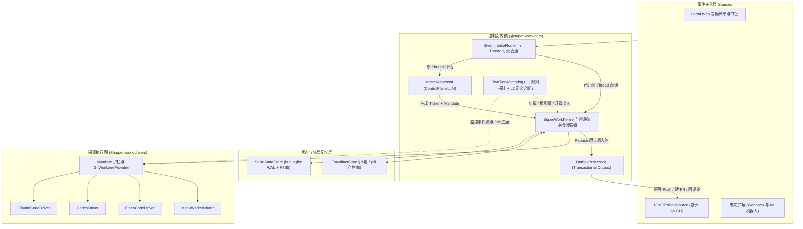
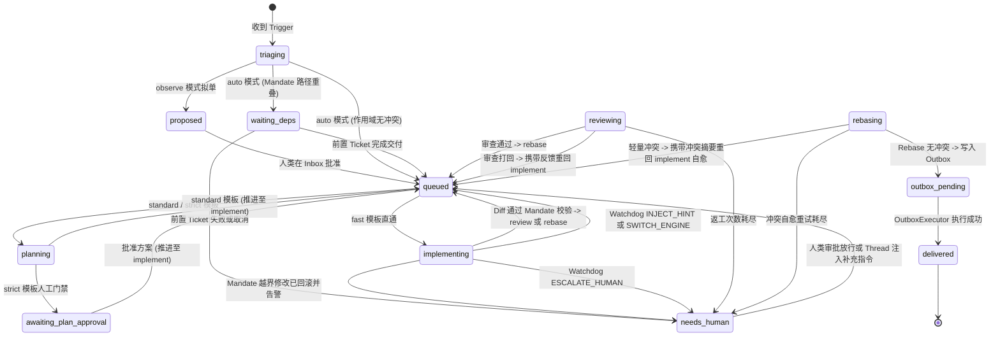

[English](./ARCHITECTURE.md) | [简体中文](./ARCHITECTURE.zh-CN.md)

# `super-work` 架构设计与核心契约

基于 DeepSeek Harness 团队《Super-agent 设计探索：迈向更自主的 Agent 系统》的核心思想，本文件定义了 `super-work` 的分层架构、阶段状态机以及四层 Bun Monorepo 核心契约。

> **核心设计信条**：系统的瓶颈是**人类的注意力带宽**而非单次模型推理。`super-work` 将开发者从“盯多个终端的微操员”转变为“审批边界与结果的决策者”——控制面常驻轻量调度，执行面复用成熟 Coding Agent，所有外部写副作用统一经由事务性发件箱（Transactional Outbox）受控释放。

---

## 1. 系统总体架构

---

## 2. Ticket 阶段状态机与跨引擎接力

---

## 3. 核心机制与契约

### 3.1 不可变 `Mandate` 与并发作用域治理
实现于 [mandate.ts](./packages/core/src/mandate.ts)：
- **授权契约**：每张 `Ticket` 携带不可变 `Mandate`，约束 `allowedPaths`、`forbiddenPaths`（强制合入 `DEFAULT_FORBIDDEN_PATHS`：`.env`、`.env.*`、`**/.env`、`**/.env.*`、`**/*.pem`、`**/*.key`）、`allowNetwork`、`allowExternalSideEffects: false`、`maxCostUsd`、`maxDurationSec` 与 `maxStageRetries`。
- **事前冲突预判**：`mandateScopesOverlap(a, b)` 在派单前检查同仓库活跃 Ticket 的路径通配符与目录前缀重合度；重叠自动写入 `dependsOn`（状态置为 `waiting_deps`），无重叠则各自在独立 worktree 并发推进。
- **双重护栏**：
  - **事前约束**：将阶段角色映射为 CLI 原生权限参数（`plan` / `review` 阶段限定只读/规划权限；`implement` 阶段禁用 `Bash(git push*)`、`Bash(gh pr *)`、`Bash(gh issue *)`）。
  - **事后审计**：调用 `validateChangedFilesAgainstMandate(...)` 校验 `GitWorktreeProvider.getChangedFiles(...)`。若发现越界或敏感文件修改，立即调用 `revertPaths(...)` 还原并向 Attention Inbox 提交 `mandate_violation` 卡片。

### 3.2 统一 `WorkerDriver` 协议与跨引擎接力
接口定义于 [ports.ts](./packages/core/src/ports.ts)，驱动实现于 `packages/drivers/src/workers/`：
- 所有执行器统一产出归一化 `WorkerStreamEvent` 流（`session_started`、`thought`、`tool_use`、`tool_result`、`text`、`usage`、`completed`、`error`）。
- **同引擎原生续跑**：捕获并持久化 `nativeSessions[engine]`（`ClaudeCodeDriver` 的 `session_id` / `CodexDriver` 的 `thread_id` / `OpenCodeDriver` 的 `sessionID`），下轮同引擎优先通过 `--resume` / `exec resume` / `--session` 复用上下文与缓存。
- **跨引擎无缝交接**：在不同阶段（如 `ClaudeCodeDriver` 编码 → `CodexDriver` / `OpenCodeDriver` 独立审查）或 Watchdog 触发 `SWITCH_ENGINE` 时，`MemoryManager` 自动提炼紧凑的 `InlineMemory` 阶段交接摘要，避免将巨量原始历史塞入新引擎上下文窗口。

### 3.3 `Inline & Spill` 分层记忆与 `Chain of Recall`
实现于 [memory.ts](./packages/core/src/memory.ts)、[sqlite-state-store.ts](./packages/drivers/src/storage/sqlite-state-store.ts) 与 [fs-artifact-store.ts](./packages/drivers/src/storage/fs-artifact-store.ts)：
- **Inline（内联记忆）**：在 `Ticket` 内仅维护轻量结构化字段（`goal`、`acceptanceCriteria`、`planSummary`、`stageNotes`、`threadUpdates`、`activeHint`）。
- **Spill（溢出产物）**：完整 JSONL 执行流与工作树统一 Diff 补丁落盘至 `<dataDir>/artifacts/<ticketId>/`，并在 SQLite `artifacts` 表登记元数据。
- **Chain of Recall（链式召回）**：`SqliteStateStore.recallChain(ticketId)` 串联还原 `Trigger -> Thread -> Ticket -> StageRuns -> SpillArtifacts` 完整血缘链，并结合转义安全处理的 `bun:sqlite` FTS5 全文检索（`tokenizeFtsQuery`）按需召回关联历史任务。

### 3.4 两级混合 `Watchdog`
实现于 [watchdog.ts](./packages/core/src/watchdog.ts)：
- **L1 零成本规则探针**：实时监控 `hard_budget_exceeded`（费用/时长硬上限）、`repeated_error`（连续 `>= 3` 次相同签名报错）、`diff_oscillation`（工作树 Diff 哈希出现 `A -> B -> A` 往复振荡）、`silence_timeout`（流式输出静默超时）及 `budget_burn`（预算消耗达 80% 仍无代码变更）。
- **L2 语义诊断**：仅在 L1 触发告警且未超出 `maxStageRetries` 时唤醒 `ControlPlaneLLM.diagnoseWatchdog(...)`，输出结构化决策：`CONTINUE`、`INJECT_HINT`、`SWITCH_ENGINE` 或 `ESCALATE_HUMAN`。

### 3.5 `Transactional Outbox` 与交付门禁
实现于 [outbox.ts](./packages/core/src/outbox.ts) 与 [gh-cli-source.ts](./packages/drivers/src/sources/gh-cli-source.ts)：
- 交付前由 `SuperWorkKernel` 自动执行 `GitWorktreeProvider.rebaseOntoBase(...)`；若发生冲突则优先注入冲突文件摘要唤醒 Worker 自愈，超出重试上限再升级人工处理。
- Rebase 干净后写入带 SQLite `UNIQUE(idempotency_key)` 约束的 `OutboxEntry`；`OutboxProcessor.processDueEntries()` 通过事务方法 `claimNextOutboxEntries` 原子认领任务并交由 `GhOutboxExecutor` 执行（有远端及 `gh` 授权时自动 Push 分支并建 PR，纯本地仓库则完成本地分支交付汇总）。
- **Worktree 生命周期与 GC**：启用仓库 `autoCleanupWorktree`（默认开启）时，任务到达 `delivered` 或被 `cancelTicket` 取消后会自动移除工作树目录并保留提交分支；即使清理或 `local_merge` 删除临时分支后，`GET /api/tickets/:id` 仍依次通过 Worktree Diff → 分支 Diff → Spill `diff` 产物三层兜底展示。
- **确定性质量门禁（Verification Gate）**：若仓库配置 `verificationCommands`，在 `implement`（`commitAll` 之前）及 `rebase` 干净后由 `GitWorktreeProvider.runVerificationCommands(...)` 强制执行，产出 `test_log` Spill 产物并发送 `verification_completed` 事件；失败时注入日志摘要自动返工，耗尽重试则升级至收件箱。
- **双通道交付与 Epic 统一集成分支（`v0.4.0`）**：默认启用 Epic 统一集成分支 `super-work/epic/<epicId>`（可切换回 `per_subtask`）；全部子任务合入集成分支后执行 `finalizeUnifiedEpic` 全局终验（失败支持 1 轮集成自愈），最终只产出 1 个聚合 PR 或 1 次原子本地合入。
- **守护进程无损断点恢复与分级扩权**：`SuperWorkKernel.recoverInterruptedRuns()` 在启动时收口孤儿 `running` StageRun、保留 Worktree 改动与 `nativeSessions` 回退至 `queued`，并重置超时 `processing` Outbox；`validateChangedFilesAgainstMandate` 区分 `forbiddenViolations`（立即回滚）与 `scopeViolations`（暂存工作树待 Inbox「一键扩权」零重烧推进）。
- **GitHub PR 返修闭环与单仓并发/日预算熔断**：`GhCliPollingSource` 拉取 PR Review 与 `gh run view --log-failed` 失败日志并过滤 `[super-work]` 自身评论，在 3 轮上限内同分支增量更新原 PR；调度器强制校验仓库级 `maxConcurrentWorkers` 与 `dailyBudgetUsd`（触发柔性熔断并暴露 `/api/metrics`），并由 `@super-work/cli` 提供全功能终端控制入口。
- **工程契约（`super-work.json`）、Worktree 预热与自进化经验库（`v0.5.0`）**：`GitWorktreeProvider.loadRepoContract` / `writeRepoContract` 支持将工程契约与共享规则从仓库根目录 `super-work.json` 自动同步到 SQLite 并支持反向导出，新 Worktree 创建后自动执行 `setupCommands`；经由门禁/审查修复闭环的任务（`maybeDistillClosedLoopLesson`）及人类收件箱批注（`distillHumanNoteToRule`）自动提炼规则存入 `playbook_entries`，并在派单时按路径匹配注入（限 Top 8 / `<= 1200` 字符）。
- **结构化对抗交叉审查、安全回滚与高信噪比触达**：`selectReviewEngine` 在实车环境中严格选用异构真实引擎互审（单引擎下开启独立只读会话盲审，绝不混用 `mock`）；`parseReviewReport` 对 `blocker`/`major` 拦截返工、对纯 `nit` 直接放行留痕并落盘 JSON `review_report`；`local_merge` 统一 `--no-ff` 并持久化 SHA 支持非破坏性 `git revert -m 1`；`NotificationDispatcher` 与可选 `SUPER_WORK_TOKEN` 鉴权、子任务穿透过滤 SSE 共同构成完整的注意力和远程安全边界。

### 3.6 `v1.0.0` GA 核心可靠性、精细审查与模块化升级
- **内核模块化重构（`packages/core/src/kernel/*`）**：将定时巡航（Routines）、Arena 双引擎对抗、Adaptive Epic Re-plan、检查点时间旅行与 DAG 手术、行级 Review 批注、System Doctor/SQLite 热备份及 `SpanRecorder` 拆分为基于 `KernelCoordinatorContext` 的独立协调模块，`SuperWorkKernel` 对外 API 保持 100% 向后兼容；Web 端通过组件拆分、`React.lazy` 与 `manualChunks` 将单包体积极限压缩至 `500 kB` 以内。
- **风险评分置信度交付门禁（[risk.ts](./packages/core/src/risk.ts)）**：`evaluateTicketRisk(...)` 综合 Diff 行数、改动文件扩散度、`sensitivePaths` 命中、符号依赖扇出、视觉像素差异、阶段重试与冲突历史扣除校验置信度，产出 `0–100` 确定性评分。仓库/工单采用 `risk_gated` 且分值高于 `riskThreshold`（默认 `35`）时自动转入 `outbox_signoff` 人工签字（默认仍为 `always_auto` 保持完全兼容）。
- **行级锚定审查工作台（[review-comments-coordinator.ts](./packages/core/src/kernel/review-comments-coordinator.ts)）**：将结构化 `ReviewFinding` 自动同步写入 SQLite `ticket_review_comments`，支持人类在 Diff 中批量收集行级批注并通过 `request_changes` 精准退回 `implement`；当后续实现修改相应文件并过门禁后自动将其标记为 `resolved`。
- **3-Way 语义变基冲突解析器（[conflict-resolver.ts](./packages/core/src/conflict-resolver.ts)）**：Rebase 冲突时保存隐藏检查点 `pre_rebase_conflict`，通过 `GitWorktreeProvider.prepareThreeWayConflictWorkspace` 构建无残留锁文件、保留标准冲突标记的双边上下文环境，在单回合限定内调用执行器协调消解并严守 `lockedTestPaths` 只读与全量门禁，失败则无损回退快照并携带 `ConflictSemanticContext` 升级 `merge_conflict`。
- **阶段分片耗时、系统巡检热备与任务蓝图（[blueprints.ts](./packages/core/src/blueprints.ts)）**：随 `StageRun.spans` 持久化各环节耗时形成瀑布流；`SystemDoctor` 与 `VACUUM INTO` 覆盖 SQLite、Worktree、Preview 及隐藏 Git Ref 巡检与在线一致性快照；5 套内置与仓库级自定义 `blueprints` 按 `explicit > blueprint > repo` 优先级合并，并在 MCP `1.0.0` 暴露 **15 个工具**。
