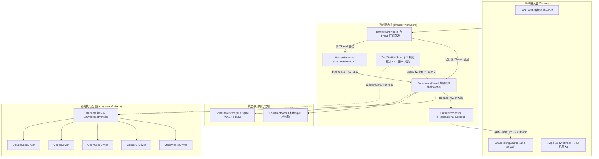
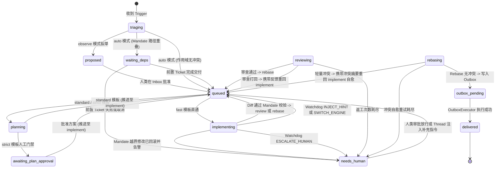

[English](./ARCHITECTURE.md) | [简体中文](./ARCHITECTURE.zh-CN.md)

# `super-work` 架构设计与核心契约

基于 DeepSeek Harness 团队《Super-agent 设计探索：迈向更自主的 Agent 系统》的核心思想，本文件定义了 `super-work` 的分层架构、阶段状态机以及四层 Bun Monorepo 核心契约。

> **核心设计信条**：系统的瓶颈是**人类的注意力带宽**而非单次模型推理。`super-work` 将开发者从“盯多个终端的微操员”转变为“审批边界与结果的决策者”——控制面常驻轻量调度，执行面复用成熟 Coding Agent，所有外部写副作用统一经由事务性发件箱（Transactional Outbox）受控释放。

---

## 1. 系统总体架构

---

## 2. Ticket 阶段状态机与跨引擎接力

---

## 3. 核心机制与契约

### 3.1 不可变 `Mandate` 与并发作用域治理
实现于 [mandate.ts](./packages/core/src/mandate.ts)：
- **授权契约**：每张 `Ticket` 携带不可变 `Mandate`，约束 `allowedPaths`、`forbiddenPaths`（强制合入 `DEFAULT_FORBIDDEN_PATHS`：`.env`、`.env.*`、`**/.env`、`**/.env.*`、`**/*.pem`、`**/*.key`）、`allowNetwork`、`allowExternalSideEffects: false`、`maxCostUsd`、`maxDurationSec` 与 `maxStageRetries`。
- **事前冲突预判**：`mandateScopesOverlap(a, b)` 在派单前检查同仓库活跃 Ticket 的路径通配符与目录前缀重合度；重叠自动写入 `dependsOn`（状态置为 `waiting_deps`），无重叠则各自在独立 worktree 并发推进。
- **双重护栏**：
  - **事前约束**：将阶段角色映射为 CLI 原生权限参数（`plan` / `review` 阶段限定只读/规划权限；`implement` 阶段禁用 `Bash(git push*)`、`Bash(gh pr *)`、`Bash(gh issue *)`）。
  - **事后审计**：调用 `validateChangedFilesAgainstMandate(...)` 校验 `GitWorktreeProvider.getChangedFiles(...)`。若发现越界或敏感文件修改，立即调用 `revertPaths(...)` 还原并向 Attention Inbox 提交 `mandate_violation` 卡片。

### 3.2 统一 `WorkerDriver` 协议与跨引擎接力
接口定义于 [ports.ts](./packages/core/src/ports.ts)，驱动实现于 `packages/drivers/src/workers/`：
- 所有执行器统一产出归一化 `WorkerStreamEvent` 流（`session_started`、`thought`、`tool_use`、`tool_result`、`text`、`usage`、`completed`、`error`）。
- **同引擎原生续跑**：捕获并持久化 `nativeSessions[engine]`（`ClaudeCodeDriver` 的 `session_id` / `CodexDriver` 的 `thread_id` / `OpenCodeDriver` 的 `sessionID`），下轮同引擎优先通过 `--resume` / `exec resume` / `--session` 复用上下文与缓存。
- **跨引擎无缝交接**：在不同阶段（如 `ClaudeCodeDriver` 编码 → `CodexDriver` / `OpenCodeDriver` 独立审查）或 Watchdog 触发 `SWITCH_ENGINE` 时，`MemoryManager` 自动提炼紧凑的 `InlineMemory` 阶段交接摘要，避免将巨量原始历史塞入新引擎上下文窗口。

### 3.3 `Inline & Spill` 分层记忆与 `Chain of Recall`
实现于 [memory.ts](./packages/core/src/memory.ts)、[sqlite-state-store.ts](./packages/drivers/src/storage/sqlite-state-store.ts) 与 [fs-artifact-store.ts](./packages/drivers/src/storage/fs-artifact-store.ts)：
- **Inline（内联记忆）**：在 `Ticket` 内仅维护轻量结构化字段（`goal`、`acceptanceCriteria`、`planSummary`、`stageNotes`、`threadUpdates`、`activeHint`）。
- **Spill（溢出产物）**：完整 JSONL 执行流与工作树统一 Diff 补丁落盘至 `<dataDir>/artifacts/<ticketId>/`，并在 SQLite `artifacts` 表登记元数据。
- **Chain of Recall（链式召回）**：`SqliteStateStore.recallChain(ticketId)` 串联还原 `Trigger -> Thread -> Ticket -> StageRuns -> SpillArtifacts` 完整血缘链，并结合转义安全处理的 `bun:sqlite` FTS5 全文检索（`tokenizeFtsQuery`）按需召回关联历史任务。

### 3.4 两级混合 `Watchdog`
实现于 [watchdog.ts](./packages/core/src/watchdog.ts)：
- **L1 零成本规则探针**：实时监控 `hard_budget_exceeded`（费用/时长硬上限）、`repeated_error`（连续 `>= 3` 次相同签名报错）、`diff_oscillation`（工作树 Diff 哈希出现 `A -> B -> A` 往复振荡）、`silence_timeout`（流式输出静默超时）及 `budget_burn`（预算消耗达 80% 仍无代码变更）。
- **L2 语义诊断**：仅在 L1 触发告警且未超出 `maxStageRetries` 时唤醒 `ControlPlaneLLM.diagnoseWatchdog(...)`，输出结构化决策：`CONTINUE`、`INJECT_HINT`、`SWITCH_ENGINE` 或 `ESCALATE_HUMAN`。

### 3.5 `Transactional Outbox` 与交付门禁
实现于 [outbox.ts](./packages/core/src/outbox.ts) 与 [gh-cli-source.ts](./packages/drivers/src/sources/gh-cli-source.ts)：
- 交付前由 `SuperWorkKernel` 自动执行 `GitWorktreeProvider.rebaseOntoBase(...)`；若发生冲突则优先注入冲突文件摘要唤醒 Worker 自愈，超出重试上限再升级人工处理。
- Rebase 干净后写入带 SQLite `UNIQUE(idempotency_key)` 约束的 `OutboxEntry`；`OutboxProcessor.processDueEntries()` 通过事务方法 `claimNextOutboxEntries` 原子认领任务并交由 `GhOutboxExecutor` 执行（有远端及 `gh` 授权时自动 Push 分支并建 PR，纯本地仓库则完成本地分支交付汇总）。
- **Worktree 生命周期与 GC**：启用仓库 `autoCleanupWorktree`（默认开启）时，任务到达 `delivered` 或被 `cancelTicket` 取消后会自动移除工作树目录并保留提交分支；即使清理或 `local_merge` 删除临时分支后，`GET /api/tickets/:id` 仍依次通过 Worktree Diff → 分支 Diff → Spill `diff` 产物三层兜底展示。
- **确定性质量门禁（Verification Gate）**：若仓库配置 `verificationCommands`，在 `implement`（`commitAll` 之前）及 `rebase` 干净后由 `GitWorktreeProvider.runVerificationCommands(...)` 强制执行，产出 `test_log` Spill 产物并发送 `verification_completed` 事件；失败时注入日志摘要自动返工，耗尽重试则升级至收件箱。
- **双通道交付与 Epic 统一集成分支（`v0.4.0`）**：默认启用 Epic 统一集成分支 `super-work/epic/<epicId>`（可切换回 `per_subtask`）；全部子任务合入集成分支后执行 `finalizeUnifiedEpic` 全局终验（失败支持 1 轮集成自愈），最终只产出 1 个聚合 PR 或 1 次原子本地合入。
- **守护进程无损断点恢复与分级扩权**：`SuperWorkKernel.recoverInterruptedRuns()` 在启动时收口孤儿 `running` StageRun、保留 Worktree 改动与 `nativeSessions` 回退至 `queued`，并重置超时 `processing` Outbox；`validateChangedFilesAgainstMandate` 区分 `forbiddenViolations`（立即回滚）与 `scopeViolations`（暂存工作树待 Inbox「一键扩权」零重烧推进）。
- **GitHub PR 返修闭环与单仓并发/日预算熔断**：`GhCliPollingSource` 拉取 PR Review 与 `gh run view --log-failed` 失败日志并过滤 `[super-work]` 自身评论，在 3 轮上限内同分支增量更新原 PR；调度器强制校验仓库级 `maxConcurrentWorkers` 与 `dailyBudgetUsd`（触发柔性熔断并暴露 `/api/metrics`），并由 `@super-work/cli` 提供全功能终端控制入口。
- **工程契约（`super-work.json`）、Worktree 预热与自进化经验库（`v0.5.0`）**：`GitWorktreeProvider.loadRepoContract` / `writeRepoContract` 支持将工程契约与共享规则从仓库根目录 `super-work.json` 自动同步到 SQLite 并支持反向导出，新 Worktree 创建后自动执行 `setupCommands`；经由门禁/审查修复闭环的任务（`maybeDistillClosedLoopLesson`）及人类收件箱批注（`distillHumanNoteToRule`）自动提炼规则存入 `playbook_entries`，并在派单时按路径匹配注入（限 Top 8 / `<= 1200` 字符）。
- **结构化对抗交叉审查、安全回滚与高信噪比触达**：`selectReviewEngine` 在实车环境中严格选用异构真实引擎互审（单引擎下开启独立只读会话盲审，绝不混用 `mock`）；`parseReviewReport` 对 `blocker`/`major` 拦截返工、对纯 `nit` 直接放行留痕并落盘 JSON `review_report`；`local_merge` 统一 `--no-ff` 并持久化 SHA 支持非破坏性 `git revert -m 1`；`NotificationDispatcher` 与可选 `SUPER_WORK_TOKEN` 鉴权、子任务穿透过滤 SSE 共同构成完整的注意力和远程安全边界。

### 3.6 `v1.0.0` GA 核心可靠性、精细审查与模块化升级
- **内核模块化重构（`packages/core/src/kernel/*`）**：将定时巡航（Routines）、Arena 双引擎对抗、Adaptive Epic Re-plan、检查点时间旅行与 DAG 手术、行级 Review 批注、System Doctor/SQLite 热备份及 `SpanRecorder` 拆分为基于 `KernelCoordinatorContext` 的独立协调模块，`SuperWorkKernel` 对外 API 保持 100% 向后兼容；Web 端通过组件拆分、`React.lazy` 与 `manualChunks` 将单包体积极限压缩至 `500 kB` 以内。
- **风险评分置信度交付门禁（[risk.ts](./packages/core/src/risk.ts)）**：`evaluateTicketRisk(...)` 综合 Diff 行数、改动文件扩散度、`sensitivePaths` 命中、符号依赖扇出、视觉像素差异、阶段重试与冲突历史扣除校验置信度，产出 `0–100` 确定性评分。仓库/工单采用 `risk_gated` 且分值高于 `riskThreshold`（默认 `35`）时自动转入 `outbox_signoff` 人工签字（默认仍为 `always_auto` 保持完全兼容）。
- **行级锚定审查工作台（[review-comments-coordinator.ts](./packages/core/src/kernel/review-comments-coordinator.ts)）**：将结构化 `ReviewFinding` 自动同步写入 SQLite `ticket_review_comments`，支持人类在 Diff 中批量收集行级批注并通过 `request_changes` 精准退回 `implement`；当后续实现修改相应文件并过门禁后自动将其标记为 `resolved`。
- **3-Way 语义变基冲突解析器（[conflict-resolver.ts](./packages/core/src/conflict-resolver.ts)）**：Rebase 冲突时保存隐藏检查点 `pre_rebase_conflict`，通过 `GitWorktreeProvider.prepareThreeWayConflictWorkspace` 构建无残留锁文件、保留标准冲突标记的双边上下文环境，在单回合限定内调用执行器协调消解并严守 `lockedTestPaths` 只读与全量门禁，失败则无损回退快照并携带 `ConflictSemanticContext` 升级 `merge_conflict`。
- **阶段分片耗时、系统巡检热备与任务蓝图（[blueprints.ts](./packages/core/src/blueprints.ts)）**：随 `StageRun.spans` 持久化各环节耗时形成瀑布流；`SystemDoctor` 与 `VACUUM INTO` 覆盖 SQLite、Worktree、Preview 及隐藏 Git Ref 巡检与在线一致性快照；5 套内置与仓库级自定义 `blueprints` 按 `explicit > blueprint > repo` 优先级合并。

### 3.7 `v1.1.0` 智能探针控制面、实时纠偏与黄金评测平台
- **两层只读代码探针系统（[readonly-repo-prober.ts](./packages/drivers/src/workspace/readonly-repo-prober.ts)）**：Layer 1 提供 `<50ms` 确定性符号/代码片段/最近提交预勘探（兼容离线 `HeuristicControlLLM`），Layer 2 在 `SpecStudio`、`EpicPlanner`、`Watchdog L2` 及路径模糊分诊时允许至多 2 轮只读工具调用（`search_symbols`、`read_file_slice`、`grep_literals`、`git_recent_commits`），经 `isProbePathAllowed` 与 `realpath` 双重校验锁死在仓库根目录内且严禁读取 `forbiddenPaths` / `.env*` / `*.pem` / `*.key`。
- **双模式 `⌘K` 幕僚长全局面板与批量审批（[chief.ts](./packages/core/src/chief.ts)）**：`runChiefOfStaffQuery`（`POST /api/chief/ask`、`super-work ask`）聚合实时工单、预算、FTS5 召回与代码探针进行只读问答，返回强制需人工二次点击确认的 `ChiefActionSuggestion[]`；Attention Inbox 与 `POST /api/inbox/batch-resolve` 支持多选及「仅选低风险」一键批量放行/驳回。
- **回合中实时纠偏、Worker `[ASK_HUMAN]` 提问与工具画像（[tool-profiler.ts](./packages/core/src/tool-profiler.ts)）**：`steerTicket(...)` 通过 `abort("live_steer")` 温和中断当前在跑回合且不计入 `stageRetries` 或污染 `failedEngines`，保留现场 Worktree 与 `nativeSessions` 并注入 `[LIVE STEER]` 无缝续跑；`extractWorkerClarificationRequest(...)` 在遇到结构化 `[ASK_HUMAN]` 提问（单工单限 1 次）时于监督/严格模式暂停生成单选审批卡，而在 `auto` 无人值守模式自动采纳 `recommendedOption` 避免整夜停摆；`buildStageToolProfile(...)` 零 LLM 统计工具调用频次、报错与耗时。
- **黄金基准回放评测、原子热恢复与可移植知识包（[eval-coordinator.ts](./packages/core/src/kernel/eval-coordinator.ts)、[knowledge-bundle-coordinator.ts](./packages/core/src/kernel/knowledge-bundle-coordinator.ts)）**：`eval_cases` 与 `eval_runs` 在独立的 `<dataDir>/eval-worktrees/` 中跨引擎并行重放已交付工单并在 `finally` 中自动清理，绝不污染线上工单/Outbox/Casebook/Bandit；`SqliteStateStore.restoreFromBackup(...)` 校验活跃执行锁、只读 `PRAGMA quick_check` 验真、先自动生成 `pre-restore` 保险快照、清理 `-wal`/`-shm` 原子换库并重跑幂等迁移；知识包支持跨仓 JSON 导入导出 Playbook + Casebook + Blueprints；MCP 协议升级至 `1.1.0` 暴露 **19 个工具**。

### 3.8 `v1.2.0` 目标战役、投机合并列车、守护服务与契约加固
- **三层模块化拆分（[sqlite-schema.ts](./packages/drivers/src/storage/sqlite-schema.ts)、[sqlite-mappers.ts](./packages/drivers/src/storage/sqlite-mappers.ts)、[kernel.ts](./packages/core/src/kernel.ts)、[app.ts](./packages/server/src/app.ts)）**：将 SQLite DDL 与行映射从 `sqlite-state-store.ts` 抽离，控制面内核进一步拆分为职责单一的协调模块（`campaign-coordinator.ts`、`merge-train-coordinator.ts`、`lifecycle-hooks.ts`、`contract-playbook-coordinator.ts`、`epic-lifecycle-coordinator.ts`、`inbox-resolution-coordinator.ts`、`stage-execution-coordinator.ts`），并将 HTTP/MCP/Webhook 路由拆分至 `packages/server/src/routes/*`。
- **指标驱动 `GoalCampaign`（[campaign.ts](./packages/core/src/campaign.ts)、[campaign-coordinator.ts](./packages/core/src/kernel/campaign-coordinator.ts)）**：通过独立 `metric-worktrees/` 测量初始指标基线，默认在隔离分支 `super-work/campaign/<id>`（或 `per_wave_merge`）上逐波次自主迭代并按正则/末行数值对比收益；若出现退化或报错则调用 `resetBranchRef` 执行**单调分支回退**并留存教训；连续 2 轮无增益、达波次上限或预算触顶时熔断转入 `campaign_paused` Inbox 卡交由人工指引或交付。
- **并行投机合并列车与跨仓释放屏障（[merge-train.ts](./packages/core/src/merge-train.ts)、[merge-train-coordinator.ts](./packages/core/src/kernel/merge-train-coordinator.ts)）**：当仓库仅有 1 笔 `local_merge` 且基线 HEAD 未变且无等待屏障时直接走 **Smart-Bypass 零开销快速通道**；并发入队时在 `train-worktrees/` 按序叠加最多 3 个 `--no-ff` 投机合并槽位并发跑校验，对连续通过的最长前缀执行一次 Fast-Forward 并完整保留各任务独立 `--no-ff` Merge SHA（**单任务 `git revert -m 1` 完整保留**），且通过 `evaluateSpeculativePrefix` 精确定位并驱逐首个失败槽位；跨仓库 Epic 默认开启 `barrierGroupId` 释放屏障并在进入 `barrier_waiting` 时提前物化 `HandoverDigest` 消除跨仓依赖死锁。
- **确定性 Hooks、不可变 `super-work.json` 与 `ServiceManager`（[lifecycle-hooks.ts](./packages/core/src/kernel/lifecycle-hooks.ts)、[service-manager.ts](./packages/drivers/src/env/service-manager.ts)）**：将 `IMMUTABLE_REPO_PATHS`（`super-work.json`、`**/super-work.json`）纳入 OS 沙箱只读白名单（Worker 可读取、禁止修改并由 Mandate 强制回滚且 `canExpandMandate: false`）；交付与升级链路分别触发阻塞型 `pre_deliver` 与尽责异步 `post_deliver` / `on_escalate` Hook（全量使用脱敏环境变量并注入 `SUPER_WORK_HOOK_*`）；新增零外部依赖 `launchd` / `systemd --user` 守护进程管理、`127.0.0.1` 回环绑定守卫、`10 MB` 日志轮转与 **21 个 MCP 工具（`1.2.0`）**。

### 3.14 `v1.8.0` Super-Agent First —— 消费级界面，专业级引擎
- **分层**：Web 是架在不变引擎之上的轻量*消费级界面*（Home / History / Settings、单行 4 项 HeaderBar、带常驻 Steer 栏的精简 DeepDiveDrawer）；高级能力收纳于可折叠的 Settings → Developer / Engine Room。内核契约未做任何变更。
- **`AutonomyPreset`**（[autonomy-preset.ts](./packages/core/src/autonomy-preset.ts)）：`guarded`（`always_signoff`）/ `smart`（`risk_gated`，阈值 35）/ `autonomous`（`always_auto`），即 **受控 / 智能 / 全权**，均为 `mode: auto`、`sandboxMode: balanced`、`smart_tiered` 验证。由 `POST /api/repos` 与 `PATCH /api/repos/:id` 通过 `getAutonomyPresetPatch` 展开；显式字段始终优先，自动重同步绝不覆盖用户 PATCH 覆盖。`normalizeAutonomyPreset` 是唯一的输入关口（REST 请求体、`.super-work.json` 契约）：接受规范名，并将旧别名 `copilot` / `standard` / `autopilot` 映射为 `guarded` / `smart` / `autonomous`，因此现有 DB 记录与契约无需迁移即可继续工作。`inferAutonomyPreset` 为未存储预设的仓库推断拨盘位置。Web 端在 `utils/superAgent.ts` 中以纯浏览器方式镜像这些辅助函数（仅 type-only 引用 core）；拨盘渲染于单栏 HeaderBar 之下的 Hero Composer 上下文工具栏。
- **零配置引导**：`POST /api/setup/quick-start`（[setup-system-routes.ts](./packages/server/src/routes/setup-system-routes.ts)）扫描 CLI 并按 `claude_cli` → `codex_cli` → `heuristic` 选择；`POST /api/repos/detect`（[repo-routes.ts](./packages/server/src/routes/repo-routes.ts)，核心为 [repo-autodetect.ts](./packages/core/src/repo-autodetect.ts) 的 `detectRepoDefaults`）为只读，返回名称、基线分支、技术栈标签（bun / node / rust / python / go）、验证命令、`smart_tiered` 策略与 `standard` 预设。
- **人类动词分类**：`classifyInboxHumanAction`（[inbox-taxonomy.ts](./packages/core/src/inbox-taxonomy.ts)）将每种收件箱类型映射为 `approve` / `answer` / `unblock`；Web 在 `utils/superAgent.ts` 中保留浏览器纯净镜像（仅类型导入 core），并含 `humanTicketPhase`、`formatScopeTokens` / `withScopeTokens`（显式 `scope:<glob>` 令牌由 `intake.ts` 的 `extractScopeTags` 解析为 `mandate.allowedPaths`）。
- **CLI**：`super-work do "<需求>" [--preview] [--wait] [--milestone <vX.Y.Z>]` 为主动词，基于 `POST /api/intake`（`--preview` 对应 `previewOnly`）。
- **版本**：各工作区包、`GET /api/mcp` 与 JSON-RPC `initialize` 的 `serverInfo.version`（[mcp-protocol.ts](./packages/core/src/mcp-protocol.ts)）均报告 `1.8.0`（27 个工具）；Web 徽标 `v1.8`。

### 3.13 `v1.7.0` 韧性与 Watchdog 2.0 可观测性（Wave 2）
- **分级熔断**：`isPersistentEngineFailure` / `getCooldownMsForFailureKind`（[engine-health.ts](./packages/core/src/engine-health.ts)）——瞬时 15 分钟、持久 24 小时。Web 在 `DoctorBackupPanel.tsx` 内本地镜像该判定（不导入 core 运行时），渲染「持久熔断」与「临时冷却」徽标。
- **Watchdog 2.0 / Flake 重试 KPI**：`buildRunDigestReport`（[digest.ts](./packages/core/src/digest.ts)）仅在非零时写入 `resilience.watchdogExtensions`（`watchdog_extended`）与 `resilience.flakeRetries`（`flake_retried`），不影响既有 `toEqual` 断言；中英文 Markdown 为每个非零计数追加一行。飞行记录器在 Watchdog 切换旁展示两项计数。
- **仅类型子路径**：`@super-work/core` 导出 `./types`（`./src/types.ts`）；`@super-work/web` 以 `workspace:*` devDependency 声明 core（为 Wave 3 类型去重铺路）。影响面规划器仍通过 `workspace:*` 解析 `core → web`。
- **v1.7.0 其他内容**：里程碑启动 Canary、Flake 重试、Safe-Refactor 并发调度 + 自动 RefactorGuard、自适应 Watchdog 2.0（Wave 1）。MCP `1.7.0`（27 个工具）、CLI `v1.7.0`、Web 徽标 `v1.7`。

### 3.12 `v1.6.0` Playbook 卫生、飞行记录器 KPI 与可选 GitHub Release（Wave 2）
- **卫生评估器（[playbook-hygiene.ts](./packages/core/src/playbook-hygiene.ts)）**：零依赖的 `evaluatePlaybookRuleHygiene(rule, source?, { pinned? })` 识别一次性审批/续跑/工单运行笔记（不区分大小写的模式、工单 ID 正则、不含约束动词的简短状态汇报型审批），永不标记 `repo_contract` 与置顶规则；`auditPlaybookEntries` 生成 `PlaybookHygieneReport`。
- **Inbox 显式勾选**：`resolveInboxItemOp` 仅在 `saveToPlaybook === true` **且**备注通过卫生检查时写入 Playbook；噪声备注被跳过，不影响 Inbox 处理。
- **治理**：`Kernel.auditPlaybookHygiene` / `pruneNoisyPlaybooks`（[contract-playbook-coordinator.ts](./packages/core/src/kernel/contract-playbook-coordinator.ts)）；默认 `disable`（`enabled:false`、`suspect:true`），`delete` 直接删除，`dryRun` 仅报告。`runSystemDoctor`（[doctor-backup-coordinator.ts](./packages/core/src/kernel/doctor-backup-coordinator.ts)）新增 `playbook_hygiene` 检查项（fix 即禁用）。对外表面：REST `GET /api/playbooks/hygiene`、`POST /api/playbooks/hygiene/prune`；CLI `playbook audit|prune [--delete]`、`doctor --prune-playbooks`；MCP `manage_playbook_hygiene`；Web Doctor 卡片。
- **飞行记录器**：`RunDigestReport.gateReuse`（来自 `gate_reused`）与 `resilience`（`engine_tripped`、`spillover_quarantined`）；仅在发生复用时 Markdown 才追加复用行。`classifyEngineError` 将 `free usage limit` / `subscribe to opencode` 判定为确定性 `quota_exhausted`。
- **可选 GitHub Release**：`executeMilestoneRelease` 支持 `createGithubRelease`；要求目标版本、`createTag`、`pushRemote` 及通过 `gh auth status`，且全部在**任何 git 变更之前**校验。推送后执行 `gh release create v<version> --notes-file <tmp>` 并返回 `githubReleaseUrl`（临时字段，不持久化）。推送后 `gh` 失败仅报告错误，不回滚已推送的标签。
- **MCP `1.6.0`（27 个工具）**：新增 `manage_playbook_hygiene`；`manage_milestones` 支持 `createGithubRelease`。Web 徽标 `v1.6`。

### 3.11 `v1.5.0` 里程碑暂存分支与干净 Squash 发布（支柱 A + B + C + D）
- **暂存（[milestone-coordinator.ts](./packages/core/src/kernel/milestone-coordinator.ts)、[stage-execution-coordinator.ts](./packages/core/src/kernel/stage-execution-coordinator.ts)）**：`integrationMode: "milestone_branch"` 时，`createMilestoneOp` 设置 `stagingBranch = super-work/milestone/<id>`，经 `WorkspaceProvider.ensureBranchExists` 从 `repo.baseBranch` 创建，并在各项工单/子任务上写入 `targetBranch` 与 `always_auto` 闸门策略（单工单另写 `startPoint`）。带 `milestoneId` 且 `targetBranch` 非基线的工单经 `mergeWaveToTargetStagingBranch` 交付（不走 Outbox，因此无 `outbox_signoff`），自举 Boot Canary 因仅在合入 `repo.baseBranch` 时触发而被跳过。`preferredRoute` 会透传给智能直投预览。
- **单次签收**：全部交付后 `syncMilestonesOp` 将里程碑置为 `ready_to_release` 并只创建一张 `milestone_ready` 收件箱项；`releaseMilestoneOp` 把 `stagingBranch`、`squashReleaseCommit`、`releaseCommitMessage` 转交 `executeMilestoneRelease`。
- **发布（[git-worktree-provider.ts](./packages/drivers/src/workspace/git-worktree-provider.ts)）**：拒绝已跟踪文件有未提交改动的工作区，记录 `preReleaseSha`，以 `--no-ff` 合并并删除暂存分支，按需升级 `package.json` 版本；Squash 时执行 `reset --soft <preReleaseSha>` 并提交一次，再校验 `HEAD^{tree}` 未变（否则恢复原 HEAD 并报错）。仅 `createTag` 时打标签，仅 `pushRemote` 时推送。
- **持久化**：`milestones.integration_mode` / `milestones.staging_branch` 列（`ensureColumn` 增量迁移）；`tickets.target_branch` 早已存在。
- **MCP `1.5.0`（26 个工具）**：新增 `manage_engine_health`（`list|reset|probe`），并为 `manage_milestones` 增加 `integrationMode`、`preferredRoute`、`squashReleaseCommit`、`releaseCommitMessage`。Web 新增暂存分支徽标、Squash 勾选、选择器与可折叠的已发布里程碑归档。

### 3.10 `v1.4.0` 里程碑波次编排与受控发布（支柱 A + B + C + D）
- **里程碑协调器（[milestone.ts](./packages/core/src/milestone.ts)、[milestone-coordinator.ts](./packages/core/src/kernel/milestone-coordinator.ts)）**：`createMilestoneOp` 对每条需求调用智能直投预览，`planMilestoneWaves` 依据 `allowedPaths` 重叠计算拓扑 `waveIndex`/`dependsOnIndices`，并以跨波 `dependsOn` 派发（依赖目标战役的项延迟派发）。`syncMilestonesOp` 由调度 tick 驱动，把工单/Epic/战役状态映射到各项，全部 `delivered` 后合成中英双语发布说明（`synthesizeMilestoneReleaseNotes` + `buildRunDigestReport`），记录 `milestone_ready` FlightEvent 并创建 `milestone_ready` 收件箱项。`releaseMilestoneOp` **只允许显式触发**（REST `POST /api/milestones/:id/release`、CLI、收件箱签发），并委托 `WorkspaceProvider.executeMilestoneRelease`；版本升级、带注释标签与推送三者相互独立、均需显式开启。
- **持久化（[sqlite-schema.ts](./packages/drivers/src/storage/sqlite-schema.ts)、[git-worktree-provider.ts](./packages/drivers/src/workspace/git-worktree-provider.ts)）**：新增 `milestones` 表与 `tickets.milestone_id` 列迁移；`executeMilestoneRelease` 带干净工作区保护，并在 `baseBranch` 上提交 `chore(release): bump version to v<version>`。
- **支柱 A/C/D**（增量验证门禁、外科手术式符号/行号地图与热点雷达、SQLite 飞行记录仪与运行摘要）为发布说明与摘要遥测提供数据。MCP `1.4.0` 共 **25 个工具**（新增 `manage_milestones`、`get_run_digest`）；Web 新增懒加载 `MilestonePanel`、里程碑派单标签页与收件箱发布说明预览。

### 3.9 `v1.3.0` 自举奠基、智能需求直投与 `GeminiCliDriver`
- **智能统一需求直投（[intake.ts](./packages/core/src/intake.ts)、[router.ts](./packages/core/src/router.ts)）**：通过 `POST /api/intake`、`POST /api/intake/preview`、`super-work intake` 与 MCP `dispatch_requirement` 接收任意自然语言需求，结合 `ReadOnlyRepoProber` 与 `ControlPlaneLLM.planRequirementIntake` / `heuristicPlanRequirementIntake` 自动路由至作用域收敛的 `single_ticket`、跨包并行 `epic_dag` 或指标驱动 `goal_campaign`。
- **自举分级自治与 Boot Canary 排空平滑重载（[self-host-coordinator.ts](./packages/core/src/kernel/self-host-coordinator.ts)、[self-host-runner.ts](./packages/drivers/src/env/self-host-runner.ts)、[scripts/dev.ts](./scripts/dev.ts)）**：守护进程启动时同步所有已注册仓库的 `super-work.json`（含 `defaultMode` 与 `defaultDeliveryChannel`）。当自身仓库主干合入非纯文档改动后，触发 `BunSelfHostRunner` 执行构建并在随机端口以 `SUPER_WORK_CANARY_MODE=1` 冷启探活 `/api/health`；探活成功即停止新派单（`isDraining()`）、等待在途任务清空并执行 `PRAGMA wal_checkpoint(TRUNCATE)`，最后以 `RELOAD_EXIT_CODE = 75` 优雅退出由监控循环秒级拉起新进程；若构建或探活失败则自动 `git revert` 坏提交，在线服务不宕机并升级待决告警至收件箱。
- **四引擎执行池、回环保留沙箱、Monorepo 软链与无饥饿 Outbox（[gemini-cli-driver.ts](./packages/drivers/src/workers/gemini-cli-driver.ts)、[os-sandbox.ts](./packages/drivers/src/sandbox/os-sandbox.ts)、[sqlite-state-store.ts](./packages/drivers/src/storage/sqlite-state-store.ts)）**：接入原生 `GeminiCliDriver`（`-p -o stream-json --skip-trust --approval-mode plan|yolo` 与 delta 增量缓冲），macOS Seatbelt 在 `balanced` 模式下保留 `localhost:*` 测试回环（`strict` 保持纯零网络隔离），工作树自动同步本地 `packages/*` 符号链接，MergeTrain 交付后即刻清理检查点 ref，SQL Outbox 认领通过 `NOT IN` 过滤挂起屏障消除队头饥饿，并将 MCP 升级至 `1.3.0`（**23 个工具**）。
