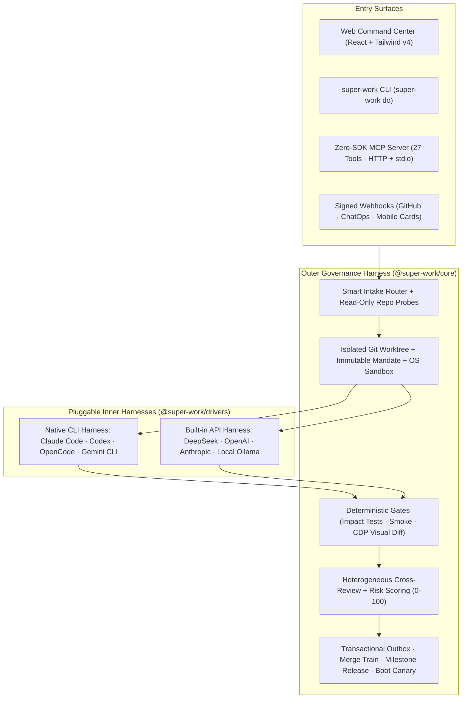

<p align="center">
  
</p>

<h1 align="center">super-work</h1>

<p align="center">
  <strong>Autonomous Software Engineering Orchestrator &amp; Local Super-Agent Command Center</strong>
</p>

<p align="center">
  
  = 1.3" />
  
  
  
</p>

<p align="center">
  <strong>English</strong> · <a href="./README.zh-CN.md">简体中文</a> · <a href="#60-second-quick-start">Quick Start</a> · <a href="./USAGE.md">Usage Guide</a> · <a href="./ARCHITECTURE.md">Architecture</a>
</p>

---

## Why `super-work`?

> **The bottleneck in AI-assisted engineering is no longer single-turn model intelligence — it is human attention bandwidth.**

Inspired by the DeepSeek Harness team's essay *"Exploring Super-agent Design: Towards a More Autonomous Agent System"*, **`super-work`** shifts developers from babysitting 3–5 interactive terminal tabs to acting as **boundary setters and outcome reviewers**. A lightweight always-on control plane routes work, enforces OS-sandboxed `git worktree` boundaries, runs deterministic verification gates, conducts heterogeneous cross-model reviews, and interrupts you **only** when a decision genuinely needs your judgment.

| Dimension | Multi-Tab Agent Babysitting | `super-work` Governed Autonomy |
| :--- | :--- | :--- |
| **Workspace safety** | Agents edit your working tree directly and collide | Every ticket runs in an isolated `git worktree` + macOS Seatbelt / Linux `bwrap` sandbox |
| **Model & cost strategy** | Locked into one vendor CLI or one API tool | **Dual-Harness Model Pool**: mix subscription CLIs (`claude`, `codex`, `opencode`, `gemini`) and HTTP APIs (`DeepSeek`, `OpenAI`, `Anthropic`, `Ollama`) per role |
| **Quality assurance** | Self-reported "tests pass" claims | Deterministic host gates (impact-scoped tests, `$PORT` runtime smoke, CDP headless browser + pixel visual diff) + blind cross-model review |
| **Human attention** | Constant prompt babysitting and raw log scrolling | Structured live execution feed + high-signal **Needs You** inbox (`Approve` · `Answer` · `Unblock`) |
| **Delivery & rollback** | Manual branch juggling or risky direct pushes | Risk-scored **Transactional Outbox**, **Speculative Merge Train**, 1-click lossless **Milestone Squash/Tag/Push**, and **1-Click Safe Revert** |

---

## Architecture — The Dual-Harness Model

`super-work` separates **deterministic outer governance** from **pluggable inner coding harnesses**, giving you deterministic safety ceilings without sacrificing native CLI coding quality or flat-rate subscription economics.



---

## 60-Second Quick Start

### Prerequisites
- **[Bun](https://bun.sh)** `>= 1.3` and **`git`** (managed repositories need at least one initial commit / valid `HEAD`)
- *Optional coding engines*: any signed-in local CLI (`claude`, `codex`, `opencode`, `gemini`), any OpenAI / Anthropic / DeepSeek API key, or local `Ollama` (`gh` CLI optional for GitHub PRs & Releases)

### 1. Install, Build & Launch

```bash
git clone https://github.com/WangShayne/super-work.git
cd super-work

bun install
bun run build
bun run dev
# Daemon API + SSE: http://127.0.0.1:4318
# Web Command Center: http://localhost:5173
```

### 2. Zero-Config Onboarding
1. Open `http://localhost:5173` — the **Setup Wizard** scans your local CLIs and configures the optimal Control / Implement / Review setup in **one click** (`POST /api/setup/quick-start`).
2. Add any local Git repository — `super-work` **auto-detects** its name, base branch, stack (Bun / Node / Rust / Python / Go), and verification commands (`POST /api/repos/detect`).

### 3. Dispatch Your First Requirement

Type a goal directly into the Web **Hero Composer**, or run from your terminal:

```bash
# Dispatch an autonomous task with explicit path scope
super-work do "Add a /healthz endpoint with latency metrics scope:packages/server/**"

# Preview the Smart Intake execution plan without creating a ticket
super-work do "Refactor auth middleware into composable guards" --preview

# Block and stream progress until verified & delivered
super-work do "Fix dark-mode contrast in Settings header" --wait

# Attach work to a versioned release milestone
super-work do "Add CSV export to telemetry digest" --milestone v1.9.0
```

---

## Core Capabilities

### 1. Consumer-Simple Surface, Pro Engine Room
- **Home Workspace**:
  - **Hero Composer**: Natural-language Smart Intake, toggleable/cancellable starter chips (`Fix a bug` · `Build a feature` · `Safe refactor` · `Cut a release`), explicit `scope:<glob>` tokens, and autonomy dial (`Guarded` / `Smart` / `Autonomous`).
  - **Needs You Inbox**: Every human interruption maps to three clear verbs — **Approve**, **Answer**, or **Unblock** — with low-risk batch triage.
  - **Live Work & SSE Replay**: Running missions show a live elapsed timer, structured tool/thought/gate headlines (never raw JSON dumps), and an expandable inline **Live** console backed by a server-side per-ticket SSE replay buffer (`GET /api/events`) that survives page refreshes.
- **DeepDive Drawer**: Phase-aware live execution cockpit (`Streaming live` / `Awaiting your decision` / `Execution finished`) with category filters, inline human decision cards at the top of the drawer, per-file Diff Studio + line-anchored **Review Basket**, hidden-ref **Stage Checkpoints**, **Live Worktree Previews**, and a permanent bottom **Live Steer** bar.
- **History & Collapsible Engine Room**: Release & ticket timelines, interactive Swimlane + SVG **DAG Studio**, 5-item Settings Essentials, `⌘K` **Chief-of-Staff** Q&A, and an expandable **Developer / Engine Room** for Contracts, Playbook/Casebook, Routines/Campaigns, Worktrees/Merge Train, Flight Recorder, System Doctor, and Golden Evals.

### 2. Unified Model Pool & Role-First Studio
- **CLI & API as Equal Peers**: Local CLIs (`claude`, `codex`, `opencode`, `gemini`) and HTTP API profiles (`DeepSeek`, `OpenAI-compatible`, `Anthropic-compatible`, `Ollama`) live as peer `ModelProfile` entries in one pool.
- **Role-First Assignment**: Bind any ready profile to **Control** (routing, decomposition, Watchdog), **Implement** (sandboxed coding), and **Cross-Review** (independent verification) — or use **1-Click Smart Recipes** (*API Control + Subscription CLI Coding*, *Dual-CLI Heterogeneous Review*, *Pure API*, *Smart Auto-Pool*).
- **Anti-Pattern Advisor & Live `/models` Discovery**: Automatically warns against same-model self-review blind spots with 1-click heterogeneous fixes, probes upstream `/models` & `/model` endpoints (`POST /api/setup/models`) so you click real model IDs instead of typing them, and supports per-CLI custom relay gateways without touching `~/.claude` or `~/.codex`.

### 3. Defense-in-Depth Isolation & Deterministic Gates
- **Isolated `git worktree` Pool**: Automatic monorepo `node_modules` / `packages/*` symlink mirroring, `setupCommands` warmup, concurrency quotas, daily budget caps, and automatic GC.
- **Immutable `Mandate` & OS Native Sandboxes**: Enforces `allowedPaths` and `forbiddenPaths` (`.env*`, `*.pem`, `*.key`, immutable `super-work.json`) via macOS `sandbox-exec` (Seatbelt) and Linux `bwrap`, plus `--tdd` red-green read-only `lockedTestPaths`. Out-of-scope edits stay quarantined in the worktree so you can **Expand Mandate & Continue** without re-burning tokens.
- **Multi-Layer Verification**: Impact-scoped static/unit gates (`impact_scoped`), ephemeral dynamic-port runtime **Smoke Gate** (`smokeCheck`), and zero-dependency **CDP Headless Browser + PNG Pixel Visual Diff Gate** (`browserCheck`).

### 4. Multi-Scale Autonomous Workflows & Self-Healing
- **Smart Requirement Intake**: Probes repository symbols and git history (`ReadOnlyRepoProber`) to route requests into a `single_ticket`, a concurrent multi-package/cross-repo `epic_dag` (with `HandoverDigest` contracts), or a quantitative `goal_campaign` loop (with monotonic regression rollback).
- **Scheduled Probe-to-Promote `Routines`**: Cron or interval patrols inspect isolated worktrees on schedule — exiting silently with zero ticket noise when healthy, and promoting a ticket only when concrete fixes or high-signal hazards are found.
- **Adaptive Watchdog 2.0 & Circuit Breakers**: Detects stream silence, repeated errors, and `A → B → A` diff oscillation; extends deadlines for active progress, switches engines on trips (15m transient vs 24h persistent quota/auth cooldowns), and resolves rebase conflicts via a **3-Way Semantic Conflict Resolver**.

### 5. Risk-Scored Delivery, 1-Click Release & Boot Canary
- **Deterministic Risk Gate (`0–100`)**: Scores diff size, `sensitivePaths`, symbol fan-out, visual delta, and retries before queuing into the **Transactional Outbox** (`local_merge` or `push_and_create_pr`) and **Speculative Parallel Merge Train** (up to 3 stacked slots with automatic bisection and **1-Click Safe Revert** via `git revert -m 1`).
- **Milestone Waves & Direct Release**: Orchestrate multi-wave backlogs (`direct_main` or single-signoff `milestone_branch`), or cut a **Direct Release** from base-branch commits — complete with bilingual Release Notes synthesis, tree-verified lossless **Squash**, annotated **Git Tag**, **Remote Push**, and optional **GitHub Release** right from the Home sign-off card.
- **Self-Hosting `BunSelfHostRunner`**: Merges into `super-work`'s own base branch build and boot a disposable **Boot Canary** on a random local port; once `/api/health` passes, active runs drain, SQLite WAL checkpoints, and the daemon hot-reloads cleanly (or auto-reverts on failure).

### 6. Compounding Repo Memory & 27-Tool Native MCP
- **Self-Cleaning Memory**: **Playbook** distills reusable engineering rules while auditing/pruning one-off approval noise (`playbook_hygiene`); **Episodic Casebook** indexes delivered solutions and flips reverted tickets into pitfall warnings via SQLite FTS5; **Golden Eval Suite** replays real tasks across engines in detached `eval-worktrees/`.
- **Ecosystem Native**: Dependency-free **MCP JSON-RPC 2.0 Server** (`GET/POST /api/mcp` + `super-work mcp` stdio bridge) with **27 tools & 3 resources**, plus HMAC-verified GitHub webhooks, ChatOps callbacks, macOS notifications, and crawler-safe mobile approval links.

---

## Autonomy Presets

Choose how much authority to delegate per repository from the Hero Composer toolbar:

| Preset | Mode & Gate Policy | When `super-work` Interrupts You | Best For |
| :--- | :--- | :--- | :--- |
| **Guarded** (`受控`) | `auto` + `always_signoff` | Pauses before **every** merge/PR delivery (plus blockers) | Critical repos, onboarding a new codebase |
| **Smart** (`智能`, default) | `auto` + `risk_gated` | Auto-ships verified low-risk work; asks on high-risk diffs or sensitive paths | Daily engineering — speed with guardrails |
| **Autonomous** (`全权`) | `auto` + `always_auto` | Ships end-to-end; pings **only** on real blockers (conflict, scope, budget) | Trusted test-covered repos, overnight runs |

---

## CLI & MCP Quick Reference

### Everyday CLI Commands

```bash
super-work do "<requirement>" [--preview] [--wait] [--milestone vX.Y.Z]
super-work status                              # Daemon, engine & queue snapshot
super-work inbox list                          # Pending human decisions
super-work inbox batch --low-risk --approve    # Batch-approve low-risk items
super-work steer <ticketId> "<instruction>"    # Mid-turn live redirection
super-work milestone list                      # Inspect active & released milestones
super-work milestone release <id> --bump --squash --tag --push
super-work ask "What is blocking delivery?"    # Read-only Chief-of-Staff probe
super-work doctor [--fix] [--prune-playbooks]  # System diagnostics & cleanup
super-work service install|start|stop|status   # macOS launchd / Linux systemd daemon
```

### Connect via MCP (Claude Code / Cursor / Antigravity)

```json
{
  "mcpServers": {
    "super-work": {
      "command": "bun",
      "args": ["run", "/absolute/path/to/super-work/packages/cli/src/index.ts", "mcp"]
    }
  }
}
```

Or connect directly over Streamable HTTP at `http://127.0.0.1:4318/api/mcp`.

---

## Monorepo Layout & Development

```text
super-work/
├── assets/             # Brand mark (logo.png, vector logo.svg)
├── packages/
│   ├── core/           # @super-work/core    — Zero-UI orchestration kernel, Mandate, Memory, Watchdog, Outbox, MCP
│   ├── drivers/        # @super-work/drivers — bun:sqlite + FTS5, GitWorktreeProvider, OS Sandbox, CLI & API drivers
│   ├── server/         # @super-work/server  — Hono HTTP/SSE daemon, replay buffer, webhooks & static UI host
│   ├── cli/            # @super-work/cli     — First-class CLI client & stdio MCP bridge
│   └── web/            # @super-work/web     — React 19 + Vite + Tailwind v4 Command Center (zero core runtime bundle)
└── scripts/dev.ts      # Concurrent server + web development supervisor (supports exit-75 self-reload)
```

```bash
bun test              # Run full unit, SQLite/FTS5, Watchdog, E2E git worktree & API test suite
bun run typecheck     # Strict TypeScript check across all 5 packages
bun run build         # Production Vite bundle -> packages/web/dist (< 500 kB per chunk)
bun run setup         # Interactive terminal CLI scan & model setup
```

---

## Environment Variables (Optional)

No environment variables are required to start — `super-work` persists model profiles encrypted/masked in local SQLite via the Web Studio and falls back to `HeuristicControlLLM` when unconfigured. See [.env.example](./.env.example).

| Variable | Description |
| :--- | :--- |
| `DEEPSEEK_API_KEY` | Auto-seeds DeepSeek control-plane LLM (`https://api.deepseek.com/v1`, `deepseek-chat`). |
| `OPENAI_API_KEY` | Auto-seeds OpenAI control-plane LLM (`https://api.openai.com/v1`, `gpt-4o-mini`). |
| `SUPER_WORK_LLM_API_KEY` / `_BASE_URL` / `_MODEL` | Custom OpenAI-compatible control-plane endpoint, key, and model override. |
| `SUPER_WORK_ENABLE_CLI_LLM=1` | Allows control-plane fallback to tool-less local `claude -p --tools ""` when no API key is set. |
| `SUPER_WORK_DATA_DIR` | Storage root for `super-work.db`, Spill artifacts, and `worktrees/` (default: `./.super-work`). |
| `PORT` / `HOST` | HTTP/SSE bind port & host (default: `127.0.0.1:4318`; non-loopback requires `SUPER_WORK_TOKEN`). |
| `SUPER_WORK_TOKEN` | Bearer / query token protecting all `/api/*` REST, MCP, and SSE routes. |
| `GITHUB_WEBHOOK_SECRET` / `SUPER_WORK_ACTION_SECRET` | HMAC secrets for `POST /api/webhooks/github` and signed mobile approval cards (`/api/webhooks/action`). |

---

## REST & SSE API Overview

| Domain | Key Endpoints |
| :--- | :--- |
| **Intake & Specs** | `POST /api/intake`, `POST /api/intake/preview`, `POST /api/specs/clarify`, `POST /api/chief/ask`, `POST /api/triggers` |
| **Tickets & Execution** | `GET/POST /api/tickets`, `GET /api/tickets/:id`, `POST /api/tickets/:id/{steer,message,deliver,revert,cancel}`, `POST /api/epics{/preview}` |
| **Review, Checkpoints & Previews** | `GET/POST /api/tickets/:id/review-comments`, `GET /api/tickets/:id/checkpoints`, `POST /api/tickets/:id/checkpoints/:cpId/restore`, `GET/POST/DELETE /api/previews` |
| **Inbox, Outbox & Merge Train** | `GET /api/inbox`, `POST /api/inbox/:id/resolve`, `POST /api/inbox/batch-resolve`, `GET /api/outbox`, `GET /api/merge-train`, `POST /api/merge-train/{flush,:id/eject}` |
| **Milestones, Campaigns & Routines** | `GET/POST /api/milestones`, `POST /api/milestones/:id/{release,cancel}`, `GET/POST /api/campaigns`, `GET/POST /api/routines`, `POST /api/routines/:id/run` |
| **Repos, Memory & Evals** | `GET/POST /api/repos`, `POST /api/repos/detect`, `PATCH /api/repos/:id`, `POST /api/repos/:id/contract/{sync,export}`, `GET/POST /api/playbooks/hygiene{/prune}`, `GET /api/memory/search`, `GET/POST /api/evals/{cases,run}` |
| **Models, System & Telemetry** | `GET /api/health`, `GET /api/setup/status`, `POST /api/setup/{quick-start,scan,configure,test-model,models}`, `GET/POST /api/system/{doctor,doctor/fix,engines,backups,reload}`, `GET /api/metrics`, `GET /api/digest` |
| **Live Stream, MCP & Webhooks** | `GET /api/events` (SSE + per-ticket replay buffer), `GET/POST /api/mcp` (JSON-RPC 2.0), `POST /api/webhooks/{github,chatops}`, `GET/POST /api/webhooks/action` |

---

## Documentation

- **User & Workflow Guide**: [USAGE.md](./USAGE.md) · [USAGE.zh-CN.md](./USAGE.zh-CN.md)
- **Architecture, Contracts & Release Evolution**: [ARCHITECTURE.md](./ARCHITECTURE.md) · [ARCHITECTURE.zh-CN.md](./ARCHITECTURE.zh-CN.md)
