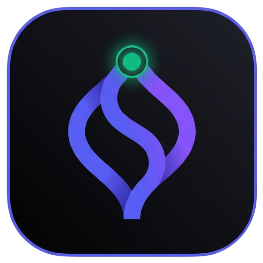
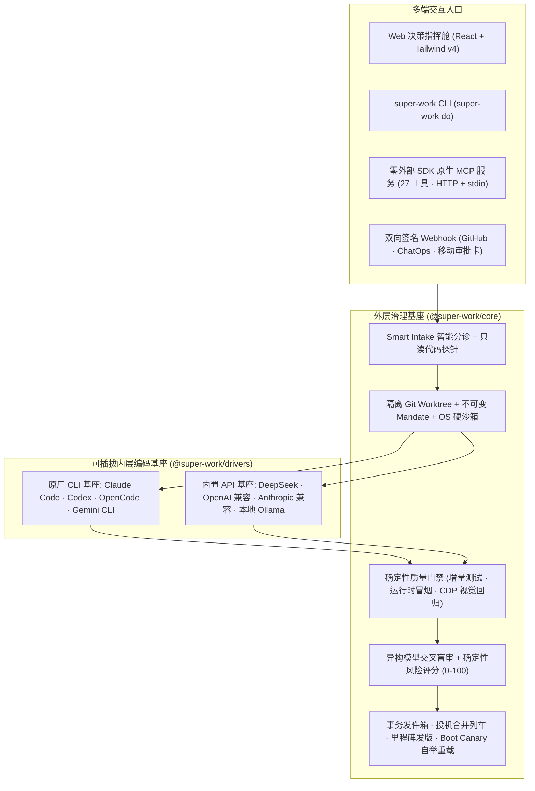

<p align="center">
  
</p>

<h1 align="center">super-work</h1>

<p align="center">
  <strong>异步自主研发工作流编排内核与本地超级智能体决策指挥舱</strong>
</p>

<p align="center">
  
  = 1.3" />
  
  
  
</p>

<p align="center">
  <a href="./README.md">English</a> · <strong>简体中文</strong> · <a href="#60-秒快速开始">快速开始</a> · <a href="./USAGE.zh-CN.md">使用指南</a> · <a href="./ARCHITECTURE.zh-CN.md">架构设计</a>
</p>

---

## 为什么需要 `super-work`？

> **AI 辅助软件工程的核心瓶颈早已不是单轮模型智商，而是人类的注意力带宽。**

受 DeepSeek Harness 团队《*Super-agent 设计探索：迈向更自主的 Agent 系统*》启发，**`super-work`** 将开发者从同时紧盯 3–5 个终端窗口的“微操监工”解放为**设定边界与签收结果的决策者**。轻量控制面常驻后台负责分诊路由、划分隔离 `git worktree` 与 OS 沙箱护栏、运行确定性验收门禁并调度异构模型交叉盲审——**只有在真正需要人类判断的时刻才打扰你**。

| 维度 | 传统多终端手动盯盘 | `super-work` 受治理的超级智能体自治 |
| :--- | :--- | :--- |
| **工作区安全** | Agent 直接改动当前目录，多任务互相覆盖污染 | 每单独立 `git worktree` + 不可变 `Mandate` + macOS Seatbelt / Linux `bwrap` 原生沙箱 |
| **模型与成本策略** | 绑定单一 CLI 订阅或单一 API 工具 | **双轨平级模型池**：按角色自由混搭原厂包月 CLI（`claude`/`codex`/`opencode`/`gemini`）与直连 API（`DeepSeek`/`OpenAI`/`Anthropic`/`Ollama`） |
| **质量把关** | 依赖模型口头声称“测试已通过” | 宿主确定性门禁（增量影响面测试、`$PORT` 动态冒烟、CDP 无头浏览器与像素级视觉对比）+ 异构模型交叉盲审 |
| **注意力消耗** | 频繁切屏喂上下文、翻看原始 JSON/SSE 报文 | 语义化实时执行动态流 + 高信噪比 **「需要你处理」** 收件箱（`批准` · `回答` · `解除阻塞`） |
| **交付与回滚** | 手工切分支合并或高风险直接 `git push` | 风险评分 **事务发件箱（Outbox）**、**并行投机合并列车**、一键无损 **里程碑 Squash/打 Tag/推送** 与 **一键安全 Revert** |

---

## 核心架构 —— 双基座（Dual-Harness）模型

`super-work` 将**确定性的外层治理基座**与**可插拔的内层编码基座**解耦：既守住确定性的安全与门禁上限，又完整保留原厂 CLI 的协同训练编码能力与包月性价比。



---

## 60 秒快速开始

### 环境要求
- **[Bun](https://bun.sh)** `>= 1.3` 与 **`git`**（被接管的本地仓库需至少包含一次初始 `git commit` / 有效 `HEAD`）
- *可选编码引擎*：任一已登录本机 CLI（`claude`、`codex`、`opencode`、`gemini`），或任一 DeepSeek / OpenAI / Anthropic 兼容 API Key，或本地 `Ollama`（如需自动提 GitHub PR / Release 可选装 `gh`）

### 1. 安装、构建与启动

```bash
git clone https://github.com/WangShayne/super-work.git
cd super-work

bun install
bun run build
bun run dev
# 守护进程 API + SSE: http://127.0.0.1:4318
# Web 决策指挥舱:     http://localhost:5173
```

### 2. 零配置引导
1. 打开 `http://localhost:5173` —— 首次运行向导会自动扫描本机已登录 CLI，**一键完成控制 / 编码 / 审查模型配置**（`POST /api/setup/quick-start`）。
2. 添加任意本地 Git 仓库 —— 系统只读探测项目技术栈（Bun / Node / Rust / Python / Go）、基准分支与测试门禁命令并自动填好（`POST /api/repos/detect`）。

### 3. 下达第一条任务

可直接在首页 **Hero Composer** 输入自然语言需求，或通过命令行一键派发：

```bash
# 指定授权范围派发任务
super-work do "新增 /healthz 健康检查接口并附带延迟统计 scope:packages/server/**"

# 仅预览智能拆单与路由计划，不实际创建工单
super-work do "将鉴权中间件重构为可组合守卫" --preview

# 阻塞等待流式输出直至门禁验收与交付完成
super-work do "修复设置页深色模式对比度细节" --wait

# 将需求归入指定版本发布里程碑
super-work do "为运行摘要新增 CSV 导出支持" --milestone v1.9.0
```

---

## 六大核心能力

### 1. 消费级简洁首页，专业级可折叠引擎室
- **首页工作台（Home）**：
  - **Hero Composer**：自然语言智能直投，常驻可切换/可二次点击取消的快捷模板胶囊（`修复 Bug` · `构建功能` · `安全重构` · `发布版本` + 一键 `取消 / 清空`），支持 `scope:<glob>` 范围标记与 `受控 / 智能 / 全权` 自治等级拨盘。
  - **需要你处理（Needs You）**：所有人工介入统一收敛为 **批准（Approve）**、**回答（Answer）**、**解除阻塞（Unblock）** 三类动作，支持低风险一键批量签批。
  - **进行中的工作与 SSE 断线重放**：运行中任务卡片直接展示实时跳秒计时器、结构化工具/思考/门禁动作标题与行内可展开 **「实况 (n)」** 面板；服务端内置环形事件回放缓冲（`GET /api/events`），中途刷新或新开页面不丢进度、无需翻看原始 SSE JSON。
- **详情抽屉（DeepDive Drawer）**：顶部内嵌待拍板交互卡片与阶段感知状态徽标（`实时推送中` / `等待你拍板` / `执行已结束`），支持按 `全部 / 工具 / 思考 / 阶段门禁` 过滤轨迹、文件级 Diff Studio + 行级审查篮（Review Basket）、隐藏 Ref 检查点时间旅行、实时工作树预览与底部常驻 **Live Steer** 实时纠偏栏。
- **历史与可折叠引擎室（Engine Room）**：发布与工单时间线、交互式泳道/SVG **DAG Studio**、5 项精要设置、`⌘K` **幕僚长只读探针问答**，以及收纳契约门禁、经验/判例库、巡航/战役、工作树/合并列车、飞行记录仪与 System Doctor 的开发者引擎室。

### 2. 双轨平级大模型池与角色优先 Studio
- **CLI 与 API 完全平级**：本机 CLI（`claude`、`codex`、`opencode`、`gemini`）与 API 模型（`DeepSeek`、`OpenAI 兼容`、`Anthropic 兼容`、`本地 Ollama`）作为同级 `ModelProfile` 统一纳管。
- **三角色自由分工 + 一键智能搭配**：独立绑定 **控制模型**（分诊/拆单/看门狗）、**工作实现模型**（隔离编码）与 **交叉审查模型**（独立盲审），内置 *API 控场 + 包月 CLI 编码*、*包月双 CLI 异构搭配*、*纯 API 自治*、*全池自动路由* 四套实时方案。
- **反模式顾问与 `/models` 实时探测**：自动识别“编码与审查同模型自审盲区”并提供一键异构修复；新增/编辑模型支持一键探测上游 `/models` 与 `/model` 接口点选真实模型 ID，并支持为单个 CLI 注入独立中转网关而不改动本机全局配置。

### 3. 纵深隔离护栏与多层确定性质量门禁
- **隔离 `git worktree` 运行池**：自动镜像 Monorepo 依赖符号链接、执行 `setupCommands` 预热、管控单仓并发配额与每日美元预算上限，终态自动回收目录。
- **不可变 `Mandate` 与 OS 原生硬沙箱**：通过 macOS Seatbelt / Linux `bwrap` 锁定写边界并屏蔽 `.env*`、`*.pem`、`*.key` 与只读 `super-work.json`；支持 `--tdd` 红绿测试文件内核级只读锁。普通越界修改保留在工作树内，支持收件箱 **「一键扩权并继续」** 免重烧 Token。
- **三层自动化验收**：基于 Diff 波及面的 **增量门禁（`impact_scoped`）**、自动分配空闲端口的 **运行时服务冒烟门禁（`smokeCheck`）**，以及零第三方依赖的 **CDP 无头浏览器控制台与 PNG 像素级视觉回归门禁（`browserCheck`）**。

### 4. 多尺度自主编排与自适应自愈
- **Smart Intake 智能路由**：结合只读代码探针（`ReadOnlyRepoProber`）自动将一句话需求路由为单工单（`single_ticket`）、跨模块/跨仓并发 `Epic DAG`（自动生成 `HandoverDigest` 契约摘要），或量化指标驱动的 **目标战役（`goal_campaign`）**（退化自动单调回退）。
- **定时探测晋升巡航（Probe-to-Promote Routines）**：按 Cron 或固定周期在隔离工作树巡检——无异常静默清理退出、绝不制造垃圾工单；仅在完成实质修复或发现高优隐患时晋升工单。
- **Watchdog 2.0 与分级熔断自愈**：实时监测流静默、重复报错与代码横跳，对有效推进自适应延时，对引擎故障执行分级熔断冷却（瞬时故障 15 分钟 / 额度或鉴权故障 24 小时自动换引擎接力），并在变基冲突时启动 **3-Way 语义冲突消解器**。

### 5. 风险评分交付、一键里程碑发版与自举金丝雀热演进
- **0–100 风险评分门禁 + 并行投机合并列车**：综合 Diff 规模、敏感路径、符号影响扇出与视觉差异计算风险分，驱动 **事务发件箱（Outbox）** 与最多 3 槽位累加验证的 **Speculative Merge Train**（单单快通 Smart-Bypass、失败槽位二分剔除，完整保留每单 `git revert -m 1` 一键回滚能力）。
- **里程碑波次编排与直接发版**：支持多需求拓扑波次推进（`direct_main` 或零中途打扰的 `milestone_branch`），也支持主干就绪后直接创建发布里程碑——在首页待发布卡片内直接勾选 **同步版本号 / 树一致性无损 Squash / 创建注释 Tag / 推送远端 `origin` / 创建 GitHub Release** 一键完成发版。
- **Boot Canary 自举热重载（`BunSelfHostRunner`）**：当改动合入 `super-work` 自身主干时，自动构建并在随机端口冷启金丝雀实例探活 `/api/health`；探活通过后排空在途任务、刷盘 SQLite WAL 并平滑热重启，若构建或探活失败则自动 `git revert` 坏提交保障在线服务不断流。

### 6. 越用越聪明的仓库记忆与 27 工具原生 MCP
- **自净化经验与判例沉淀**：**Playbook 经验库**内置噪声卫生审计（自动拦截一次性审批备注污染并支持一键清理），**Casebook 历史判例库**支持 SQLite FTS5 混合召回并在工单回滚时自动翻转为反面避坑警示，配合隔离 **Golden Eval 黄金评测台** 与 **`VACUUM INTO` 零锁在线热备份/原子恢复**。
- **原生生态互联**：零外部 SDK 的 **MCP JSON-RPC 2.0 服务**（`GET/POST /api/mcp` 与 `super-work mcp` stdio 桥接）暴露 **27 个工具与 3 个资源**，并支持 GitHub HMAC 入站 Webhook、飞书/Slack/Discord 通知及防爬虫误触的移动端签名拍板卡片。

---

## 三档自治预设（Autonomy Presets）

可在首页输入框工具栏随时按仓库切换委托权限：

| 预设档位 | 运行与门禁策略 | 何时打扰你 | 适用场景 |
| :--- | :--- | :--- | :--- |
| **受控（Guarded）** | `auto` + `always_signoff` | 每次合入主干 / 建 PR 前均停下等你签字（含异常阻塞） | 核心生产仓库、首次接入新代码库 |
| **智能（Smart，默认）** | `auto` + `risk_gated` | 低风险改动通过全量门禁与盲审后自动合入；高风险或触及敏感路径时请你拍板 | 日常主力研发 —— 兼顾吞吐效率与安全护栏 |
| **全权（Autonomous）** | `auto` + `always_auto` | 端到端全自动交付；**仅**在真实受阻（冲突、越界、超预算）时通知你 | 测试完备的成熟仓库、夜间无人值守推进 |

---

## CLI 与 MCP 速查

### 常用 CLI 指令

```bash
super-work do "<需求描述>" [--preview] [--wait] [--milestone vX.Y.Z]
super-work status                              # 查看守护进程、可用引擎与队列快照
super-work inbox list                          # 查看待拍板的收件箱事项
super-work inbox batch --low-risk --approve    # 一键批量批准低风险待决项
super-work steer <ticketId> "<纠偏指令>"       # 回合中无损实时纠偏并续跑
super-work milestone list                      # 查看活跃与历史发布里程碑
super-work milestone release <id> --bump --squash --tag --push
super-work ask "当前有哪些阻塞风险？"          # 幕僚长只读代码与态势探针问答
super-work doctor [--fix] [--prune-playbooks]  # 系统体检、孤儿目录回收与噪声规则清理
super-work service install|start|stop|status   # 管理 macOS launchd / Linux systemd 常驻服务
```

### 接入 MCP 客户端（Claude Code / Cursor / Antigravity）

```json
{
  "mcpServers": {
    "super-work": {
      "command": "bun",
      "args": ["run", "/absolute/path/to/super-work/packages/cli/src/index.ts", "mcp"]
    }
  }
}
```

也可直接连接 Streamable HTTP 端点：`http://127.0.0.1:4318/api/mcp`。

---

## Monorepo 分包结构与开发命令

```text
super-work/
├── assets/             # 品牌视觉资产 (高清透明 logo.png、纯矢量 logo.svg)
├── packages/
│   ├── core/           # @super-work/core    — 零 UI 编排内核、Mandate、记忆、看门狗、Outbox、MCP 协议
│   ├── drivers/        # @super-work/drivers — bun:sqlite + FTS5、GitWorktreeProvider、OS 沙箱、CLI 与 API 驱动
│   ├── server/         # @super-work/server  — Hono HTTP/SSE 守护进程、实时回放缓冲、Webhook 与静态前端托管
│   ├── cli/            # @super-work/cli     — 一等公民命令行客户端与 stdio MCP 桥接器
│   └── web/            # @super-work/web     — React 19 + Vite + Tailwind v4 决策指挥舱（零 core 运行时打包）
└── scripts/dev.ts      # 前后端并行开发与自举热重载（exit 75）守护启动器
```

```bash
bun test              # 运行全量单元、SQLite/FTS5、Watchdog、真实 Git Worktree E2E 与 API 测试
bun run typecheck     # 全工作区 5 个包严格 TypeScript 类型检查
bun run build         # 构建生产前端静态产物至 packages/web/dist（单分包均 < 500 kB）
bun run setup         # 终端交互式 CLI 环境扫描与模型引导配置
```

---

## 环境变量（全部可选）

无需配置任何环境变量即可启动——所有模型配置与密钥均可在 Web「大模型与角色」Studio 中可视化管理并掩码持久化于本地 SQLite，未配置外部模型时自动使用离线零消耗的 `HeuristicControlLLM`。模板见 [.env.example](./.env.example)。

| 环境变量 | 说明 |
| :--- | :--- |
| `DEEPSEEK_API_KEY` | 自动注入 DeepSeek 控制面配置（默认 `https://api.deepseek.com/v1` · `deepseek-chat`）。 |
| `OPENAI_API_KEY` | 自动注入 OpenAI 控制面配置（默认 `https://api.openai.com/v1` · `gpt-4o-mini`）。 |
| `SUPER_WORK_LLM_API_KEY` / `_BASE_URL` / `_MODEL` | 自定义 OpenAI 兼容控制面接口密钥、地址与模型覆盖。 |
| `SUPER_WORK_ENABLE_CLI_LLM=1` | 无 API Key 时允许控制面降级复用无工具受限模式的本机 `claude -p --tools ""`。 |
| `SUPER_WORK_DATA_DIR` | `super-work.db`、Spill 产物与 `worktrees/` 存储目录（默认 `./.super-work`）。 |
| `PORT` / `HOST` | 守护进程监听端口与地址（默认 `127.0.0.1:4318`；绑定非回环地址强制要求 `SUPER_WORK_TOKEN`）。 |
| `SUPER_WORK_TOKEN` | 保护所有 `/api/*` REST、MCP 与 SSE 端点的 Bearer / Query 鉴权令牌。 |
| `GITHUB_WEBHOOK_SECRET` / `SUPER_WORK_ACTION_SECRET` | `POST /api/webhooks/github` 入站验签与移动端一键审批卡片（`/api/webhooks/action`）签名密钥。 |

---

## REST 与 SSE 接口速览

| 领域模块 | 核心端点 |
| :--- | :--- |
| **智能分诊与幕僚** | `POST /api/intake`、`POST /api/intake/preview`、`POST /api/specs/clarify`、`POST /api/chief/ask`、`POST /api/triggers` |
| **工单与并发编排** | `GET/POST /api/tickets`、`GET /api/tickets/:id`、`POST /api/tickets/:id/{steer,message,deliver,revert,cancel}`、`POST /api/epics{/preview}` |
| **审查、快照与预览** | `GET/POST /api/tickets/:id/review-comments`、`GET /api/tickets/:id/checkpoints`、`POST /api/tickets/:id/checkpoints/:cpId/restore`、`GET/POST/DELETE /api/previews` |
| **收件箱、发件箱与合并列车** | `GET /api/inbox`、`POST /api/inbox/:id/resolve`、`POST /api/inbox/batch-resolve`、`GET /api/outbox`、`GET /api/merge-train`、`POST /api/merge-train/{flush,:id/eject}` |
| **里程碑、战役与巡航** | `GET/POST /api/milestones`、`POST /api/milestones/:id/{release,cancel}`、`GET/POST /api/campaigns`、`GET/POST /api/routines`、`POST /api/routines/:id/run` |
| **仓库、记忆与评测** | `GET/POST /api/repos`、`POST /api/repos/detect`、`PATCH /api/repos/:id`、`POST /api/repos/:id/contract/{sync,export}`、`GET/POST /api/playbooks/hygiene{/prune}`、`GET /api/memory/search`、`GET/POST /api/evals/{cases,run}` |
| **模型池、自检与遥测** | `GET /api/health`、`GET /api/setup/status`、`POST /api/setup/{quick-start,scan,configure,test-model,models}`、`GET/POST /api/system/{doctor,doctor/fix,engines,backups,reload}`、`GET /api/metrics`、`GET /api/digest` |
| **实时流、MCP 与 Webhook** | `GET /api/events`（SSE + 按工单重放缓冲）、`GET/POST /api/mcp`（JSON-RPC 2.0）、`POST /api/webhooks/{github,chatops}`、`GET/POST /api/webhooks/action` |

---

## 延伸文档

- **完整操作与实战手册**：[USAGE.zh-CN.md](./USAGE.zh-CN.md) · [USAGE.md](./USAGE.md)
- **架构设计、核心契约与版本演进志**：[ARCHITECTURE.zh-CN.md](./ARCHITECTURE.zh-CN.md) · [ARCHITECTURE.md](./ARCHITECTURE.md)
